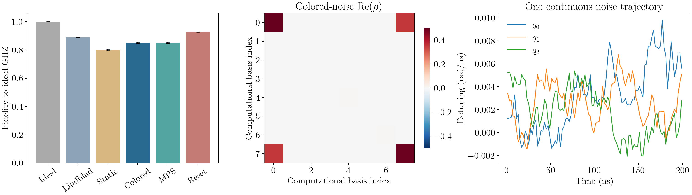

# 有限时长量子门与非马尔可夫噪声：可运行的数值原型

**项目目录：** 对应的文稿位于同级目录 [../Overleaf/](../Overleaf/)，两者是独立 Git 仓库。

有限时长控制、有时间关联的噪声，以及基于 TensorCircuit 的 SPP 张量网络与误差缓解数值实现。所有结果均为合成模拟，模型假设和验证范围见各基准报告。

## 新增：TensorCircuit SPP 张量网络包（2026-11-04）

[`spp_tn/README.md`](spp_tn/README.md) 是新包的使用和维护入口。依据相邻 Overleaf 项目的 `note.tex` 与本仓库 HTML 方案，采用统一的 **gate-after** 约定，实现经典 Hermite HEOM 的层级 MPS（压缩 RK4）、逐层 HEOM→时间 MPS、Walsh／PEA、约束 ALS-PEC 及独立小系统检查。TensorCircuit-NG 和 legacy TensorCircuit 在不同环境中验证。旧 `nmnoise/` 的量子浴与两时段基准仍独立保留。

新包不等同于完整复现 HTML：TDVP、大规模 signed-PEC 采样、通用实验学习及四比特多模扩展的性能验证仍是 TODO。安装、运行、约定和证据边界见新包 README。

本地 NG／legacy 两套环境各 **36 项测试通过**。新增结果：[一比特 PEA／PEC 与收敛](results/spp_tn_20261104_final/README.md)、[四比特单模构造对照](results/spp_tn_ising4_mps_20261104/README.md)。四比特原型目前比小模型稠密参考慢，未建立扩规模收益；完整历史非负性尚未验证。

2026-11-04 环境迁移：本项目改用独立 conda **TensorCircuitNG**（配置：[`environment.yml`](environment.yml)），原 `.venv-spp` 已移入回收站。新环境通过全部 36 项项目测试；旧 `TensorCircuit` 环境的运行依赖及四个后端已修复并补齐，门／后端上游测试 124 通过、3 跳过。版本、OpenMP 设置和验证记录统一见 [`environments/README.md`](environments/README.md)。

## 项目参考文献：Zotero 群组入口

本项目的共享参考文献集中在 **Error-Mitigation → Non-Markov**。优先从此集合查找相关论文；2026-10-27 经本机 Zotero API 核对，共 **8 篇**。

- [在 Zotero 桌面端选中集合](zotero://select/groups/6729418/collections/FH728L4C) · [Zotero 网页集合](https://www.zotero.org/groups/6729418/collections/FH728L4C)（访问取决于群组权限）。
- 本机阅读入口：[references-local/](references-local/)，内有 6 个 PDF 软链接；原文件位于 `~/Zotero/storage/<附件目录>/`。精确路径与校验和保存在该目录的 `manifest.json`。
- **集合不是磁盘文件夹。** 当前群组不允许存储文件附件；本地入口关联的是本机找到的同名 PDF，不能据此认定 PDF 已共享到群组。新增的 Chen et al. 文献在条目 URL 中提供 arXiv v2 PDF 链接。`~/Documents/Research/library/` 也不是这个集合的实时镜像。
- 软链接目录仅供本机阅读，已加入 `.gitignore`，不会把 PDF 或本机路径提交到公开仓库；换机器或 Zotero 移动/清理文件后需重新核对。

| 文献（链接到群组条目） | 本机 PDF |
|---|---|
| [Simulation of one and two qubit superconducting quantum gates under the non-Markovian 1/f noise](https://www.zotero.org/groups/6729418/items/AXEGG4GX) | [在线 PDF（v2）](https://arxiv.org/pdf/2509.07693v2)；项目根目录副本已移到回收站 |
| [Techniques for learning sparse Pauli-Lindblad noise models](https://www.zotero.org/groups/6729418/items/3KEF6BYP) | 未找到；[论文入口](https://arxiv.org/abs/2311.15408) |
| [Spatiotemporal Pauli processes: Quantum combs for modeling correlated noise in quantum error correction](https://www.zotero.org/groups/6729418/items/78U7DMZM) | [打开 PDF](references-local/spp.pdf) |
| [Single snapshot non-Markovianity of Pauli channels](https://www.zotero.org/groups/6729418/items/5MLII58Q) | [打开 PDF](references-local/single-snapshot.pdf) |
| [Efficient Lindblad synthesis for noise model construction](https://www.zotero.org/groups/6729418/items/726QD8UT) | [打开 PDF](references-local/lindblad-synthesis.pdf) |
| [Quantum error mitigation via matrix product operators](https://www.zotero.org/groups/6729418/items/VMERBHR8) | [打开 PDF](references-local/mpo-mitigation.pdf) |
| [Tensor network characterization and mitigation of readout errors](https://www.zotero.org/groups/6729418/items/QCBVXIMF) | [打开 PDF](references-local/readout-mpo.pdf) |
| [Observable Estimation in the Absence of Classical Verification](https://www.zotero.org/groups/6729418/items/UNTETZAX) | [在线 PDF（v1）](https://arxiv.org/pdf/2607.25998v1)；原本机软链接于 2026-10-28 核对时失效 |

## 说明与使用

### 报告、图表与数据

- [完整讨论稿：时间相关效应的分辨与张量网络表示（2026-11-02）](docs/spp-memory-discussion-20261102.md)：可脱离聊天上下文阅读，包含两时段例子、原配对脉冲任务、SPP/压缩的作用、下一步建议及现有证据边界，供合作者讨论。

- [SPP 太大了，张量网络能帮上忙吗？](docs/spp-too-big.md)：2026-11-04 单独整理的讨论稿，从参数空间问题讲到逐层构造，结合这次四比特表示、单比特收敛与缓解结果，说明目前验证到哪里以及下一步需要做什么。

- [周四讨论准备：SPP 参数规模与张量网络计算可行性（2026-11-05）](docs/spp-tensor-network-meeting-20261105.md)：2026-11-04 已补充四比特单模时间 MPS、单比特相关/独立 PEC 对照和层级收敛数据，附可展示的 PNG/PDF 与重绘脚本；明确最终存储、计算成本及验证范围。

- [HEOM–SPP 误差缓解研究方案（HTML 原文）](docs/heom-spp-proposal-20261029.html)：文内署名陈胤伽、日期 2026-10-29，2026-11-02 收录用户提供的原文件。内容包括四比特 Ising Trotter 分层、MPS-HEOM 到 SPP、PEA 与 PEC 变分求逆；保留原始图示和排版，方案中的实现与结果表述尚未由本项目独立核验。公式渲染与部分字体需联网加载。

- [四比特 Ising 的受限 SPP/PEC 数值基准（2026-10-29）](docs/spp-ising-benchmark.md)：两噪声时段、单站点单模量子浴，完成 HEOM→SPP、末态计数学习、独立层留出对照和准概率 PEC。含收敛、学习误差、采样成本与源码快照；全部为合成结果，未核验合作者源码或真机。

- [IBM 2607.25998 文献核对（2026-10-28；2026-10-29 补充）](docs/ibm-2607-25998-review.md)：开头比较与 2023 Nature utility 文章的关联、旋转角验证及两者的验证边界。核心仍为 SPL-PEC，但 F.2 另有准静态相关模型的参数拟合，用于残余偏差评估；未展示完整 SPP 学习与求逆。
- [从 SPL 到 SPP：基础解释（2026-10-27）](docs/spl-to-spp-explainer.md)：从逐层噪声通道到联合分布，含两层延拓和仅测末态的学习例子。

- [数值模拟报告（2026-09-21）](docs/simulation-report.md)：模型、终态、误差检查和结论边界。
- [研究方案](docs/research-plan.md)：小系统验证、跨门记忆诊断和后续误差缓解研究。
- [首要研究 proposal：真机能否分辨时间记忆](docs/paired-pulse-proposal.md)：配对脉冲实验、模型比较及数值扫描入口。
- [合作者新方案：SPP 学习与缓解（2026-10-21）](docs/paired-pulse-proposal.md#合作者新方案学习时空-pauli-过程并用于预测与缓解2026-10-21)：四步路线、最小实验、可辨识性与文献边界。
- [配对脉冲扫描结果（2026-10-15）](docs/paired-pulse-proposal.md#首轮数值结果2026-10-15)：参数区域、独立复核与统计限制。
- [Pauli 噪声的模型层级（2026-10-22）](docs/pauli-noise-model-hierarchy.md)：Markov 半群、单快照 pseudo-Lindblad、真记忆三层的定义、显式公式与可分性判据。
- [完整数值记录](results/validated/summary.json)与[终态密度矩阵](results/validated/final_states.npz)。
- [复现与备份说明](docs/backup-and-reproduce.md)。
- [待办与研究讨论](#待办todo)：真机验证设想、噪声学习问题与文献边界，统一记录在本文件。

合作者建议先阅读数值报告中的“读图说明”，再查看研究方案。`results/validated/` 是报告采用的主数据；`results/demo/` 仅保留早期试运行。当前结果是给定模型下的数值验证，尚未对接真机或完成器件噪声学习。



这里已经实现并交叉验证四种求解路线。它们区分两个独立选择：**环境的物理模型**与**演化的数值表示**。

| 路线 | 环境模型 | 数值表示 | 当前示例 |
|---|---|---|---|
| dense trajectories | 经典 Gaussian 有色噪声 | 系统态矢量、逐时间格完整矩阵指数 | 3 比特有限时长 GHZ 电路 |
| MPS trajectories | 与 dense 完全相同的噪声轨迹 | 真正的空间 MPS，局部门与 SVD | 与 dense 逐样本对照 |
| HEOM | 热平衡量子谐振子浴 | 系统密度矩阵及辅助密度算符 ADO | 单比特门序列、两个浴模 |
| explicit bath | 与 HEOM 完全相同的浴 | 系统与截断谐振子联合密度矩阵 | 对 HEOM 独立验证 |

另外提供静态失谐、连续 Lindblad 以及每个脉冲后重置环境的诊断对照。

**下述旧 `nmnoise` 模拟没有实现 HEOM 层级的 MPS 压缩或 TEMPO。** 其中的 MPS 压缩系统态，环境记忆由持续的随机轨迹保存。新 `spp_tn` 包另行实现经典 Hermite 层级的 MPS 与 SPP 时间 MPS；它不改变旧量子浴示例的实现。论文中的 MPS-HEOM 压缩辅助层级，TEMPO / process tensor 可压缩时间方向的影响泛函，不能混称。

### 运行

首次使用创建项目专用 conda 环境（Python 3.11，依赖版本已固定）：

```bash
git clone https://github.com/Qubit-Fernand/non-markovian-noise.git
cd non-markovian-noise
conda env create -f environment.yml
conda activate TensorCircuitNG
python -m pytest -q
```

也可以先自行准备 **Python 3.11** 的干净环境，再使用标准 pip 入口：

```bash
python -m pip install -r requirements.txt
python -m pip check
python -m pytest -q
python -m spp_tn.demo --output results/my_spp_run --convergence
```

[`requirements.txt`](requirements.txt) 固定了 TensorCircuit-NG 1.10.0、NumPy 2.4.6、SciPy 1.15.2、QuTiP 5.2.2 等经过验证的版本，并以 editable 方式安装本仓库。`environment.yml` 复用同一文件，避免两套版本漂移。不要在同一环境中同时安装 `tensorcircuit` 与 `tensorcircuit-ng`。核心求解器和测试无需系统 LaTeX；生成论文风格图表时才需要安装 LaTeX 和字体。macOS ARM 已本地验证；Linux 等其他平台尚未验证，跨平台允许浮点舍入差异。

查看已有报告、PNG 图和结果数据无需重跑。生成新图前需要安装系统 LaTeX 和 Times New Roman 字体；绘图配置位于 `run_demo.py` 的 `make_plot()`。快速试运行和完整运行分别为：

```bash
python run_demo.py --samples 32 --skip-quantum --output results/quickstart
python run_demo.py --samples 2048 --output results/reproduced
```

本机已有 `TensorCircuitNG` conda 环境，可直接运行：

```bash
conda run -n TensorCircuitNG python run_demo.py --samples 2048 --output results/my_run
conda run -n TensorCircuitNG python -m pytest -q
```

默认运行 3 比特；`--qubits 4` 改为 4 比特，`--dt 1` 减小时间步长，`--sigma 0.002` 改变失谐标准差。`--skip-quantum` 仅跳过量子浴示例。每次选择一个新的 `--output` 目录，脚本不会覆盖已有 `summary.json`。

依赖范围见 `pyproject.toml`，固定安装版本统一见 `requirements.txt`；各次归档运行的版本见结果记录及 Git 历史。核心求解器不依赖 LaTeX。输出图中的误差棒为轨迹 Monte Carlo 的一个标准误，不是硬件 shots 的误差。

输出包括：

- `summary.json`：参数、版本、终态指标、误差与运行时间。
- `final_states.npz`：各经典噪声模型的完整复数终态密度矩阵。
- `quantum_states.npz`：量子浴各解法在初始时刻及每个脉冲末的密度矩阵。
- `colored_noise.npy`：dense 与 MPS 共用的完整随机轨迹。
- `comparison.png`：结果对照、终态矩阵实部、一条连续噪声样本。

JSON 中的时间是单次端到端计时，可能包含首次导入和缓存开销，不能直接用于宣称某个算法更快。

读取完整终态：

```python
import numpy as np
rho = np.load("results/my_run/final_states.npz")["colored_dense"]
print(rho)
print(np.diag(rho).real)
```

### 经典有色噪声例子

采用 hbar=1，时间单位 ns，Hamiltonian 系数及失谐单位 rad/ns。第 0 个比特是最左边的 tensor factor，计算基排列为 `000,001,...,111`。

系统从 `|000>` 出发，控制顺序为：

1. 第 0 比特 `Ry(pi/2)`，20 ns。
2. `CX(0,1)`，80 ns。
3. `CX(1,2)`，80 ns。
4. 等待，20 ns。

理想结果为 `(|000>+|111>)/sqrt(2)`。这里 CNOT 用可直接验证的理想控制 Hamiltonian 实现，不是器件拟合的 CR 门：

$$
H_{CX}=\frac{\pi}{\tau} |1\rangle\langle1|\otimes\frac{I-X}{2}.
$$

整个脉冲期间同时作用

$$
H(t)=H_{\mathrm{ctrl}}(t)+\frac12\sum_i\xi_i(t)Z_i.
$$

因此噪声不是等门结束以后才加上去。dense 每个时间格直接指数化总 Hamiltonian。MPS 采用 Strang 分裂 `noise(h/2) -> control(h) -> noise(h/2)`；这只是一个随 h 收敛的数值积分方法，不是物理上假设门和噪声分离或在门间重置环境。

#### 有记忆的噪声如何产生

每个比特的噪声独立，由 K=12 个平稳 Ornstein-Uhlenbeck 过程相加：

$$
C_\xi(t)=\frac{\sigma^2}{K}\sum_k e^{-\gamma_k|t|},\qquad
S_\xi(\omega)=\frac{\sigma^2}{K}\sum_k\frac{2\gamma_k}{\gamma_k^2+\omega^2}.
$$

定义 `C(t)=integral S(omega) exp(-i omega t) d omega/(2*pi)`。默认 `sigma=0.004 rad/ns`，`gamma_k` 在 `[1e-4,0.1] ns^-1` 上对数均匀。等权重对数分布的 Lorentzian 之和只在频带内部近似 `1/|omega|`；低频趋于常数，高频按 `1/omega^2` 衰减，方差有限。它不是无截止的严格 `1/f`，也不是原论文量子谱的原样实现。

每次执行都保存同一条噪声轨迹直到电路结束；系统门不会重采样环境。输出的混态是

$$
\rho(T)\approx\frac1M\sum_r|\psi_r(T)\rangle\langle\psi_r(T)|,
$$

不是先平均态矢量再取外积。轨迹平均不等于真实实验里每个 shot 都独立重新采样慢噪声；研究跨 shot 漂移还需要单独的采集时间模型。

这里“有记忆”指时间相关性及跨门历史的保留；代码没有将它与 CP-indivisibility 或某个特定 non-Markovianity witness 等同，也没有计算这些判据。

#### 对照的含义

- quasi-static：每个比特每条电路采样一个固定失谐，与有色模型匹配瞬时方差。
- reset：每个脉冲边界重新采样平稳环境，是人为切断记忆的消融实验，不是默认物理假设。
- Lindblad：控制和耗散同时演化，单比特自由相干度为 `exp(-gamma_phi*t)`。用有色模型在 100 ns 的 Ramsey 相干度校准这个单一速率。它不是多数据拟合得到的最优 Markovian 模型。

这些对照用于演示“不同物理假设会给出不同终态”，并不证明某个模型更符合实际硬件，也不把噪声变小与模型更准确混为一谈。

### 量子浴例子

为了真正包含量子环境及反作用，而不仅是经典随机 Hamiltonian，另一个例子演化

$$
H_{\mathrm{tot}}(t)=H_{\mathrm{ctrl}}(t)+\sum_k\omega_k a_k^\dagger a_k
+\frac Z2\sum_k g_k(a_k+a_k^\dagger).
$$

系统初态 `|0>`，浴初态为独立 Gibbs 态，初始系统与浴因子化。采用 `Ry(pi/2)`、等待、`Rx(pi/2)`、等待，各 10 ns。浴相关函数为

$$
C_B(t)=\sum_k g_k^2[(n_k+1)e^{-i\omega_k t}+n_k e^{i\omega_k t}],\qquad
n_k=(e^{\beta\omega_k}-1)^{-1}.
$$

这个相关函数包含虚部与正负频率不对称。经典实 Gaussian 噪声不能一般地重现它。

`mode_parameters()` 用有限频带上的对数中点求积，离散化对称谱 `1/|omega|`，每个对数频率格分配相同方差。默认频带为 `[0.015,0.24] rad/ns`，两个中点频率为 `[0.03,0.12] rad/ns`，`sigma=0.03 rad/ns`、`beta=60 ns`。这是一组方便独立数值核验的参数，**不是论文的 50 mK 参数或实际器件参数**。

- HEOM 用 QuTiP 的 `BosonicBath` 和 `HEOMSolver`；每次更换脉冲 Hamiltonian 时，继续传递完整 ADO 状态。
- 显式浴将谐振子截断到有限 Fock 空间，直接演化联合密度矩阵，再对浴求偏迹。
- 运行比较 HEOM 深度 4/6、Fock 截断 5/7，并报告终态 trace distance。
- 两个振子只是粗离散模型，会有有限模回归效应。即使 HEOM 与显式浴完全一致，也不证明已收敛到连续 `1/f` 环境。

增加 `modes` 会快速增加 HEOM ADO 数量，显式浴维数也按 `2*fock**modes` 增长。代码设有资源上限，避免误触非常大的计算。温度升高后显式 Fock 截断可能要大很多；此时它通常只适合作为小模型基准。

### 修改初态与控制

`Pulse` 包含名称、持续时间、作用位点和局域 Hamiltonian。经典 dense/MPS 支持一比特与相邻两比特的分段常数控制、一般纯初态；支持任意位点的门或多个同时局域控制项需要扩展当前接口。初态应归一化。量子浴接口支持单比特密度矩阵初态。

```python
from nmnoise.core import ghz_schedule, ensemble_rho
from nmnoise.classical import ou_noise, dense_trajectories
from nmnoise.mps import mps_trajectories

pulses = ghz_schedule(4)
noise = ou_noise(pulses, n=4, dt=2, samples=256, sigma=0.004, seed=7)
states = dense_trajectories(pulses, noise, dt=2)
rho = ensemble_rho(states)
states_mps, diagnostics = mps_trajectories(pulses, noise, dt=2, substeps=2)
```

MPS 可以指定 `max_bond` 与 `svd_cutoff`，记录丢弃权重及归一化偏差。当前为方便比较，会在终点还原完整态矢量并输出完整密度矩阵，所以它是小系统验证原型，不是已经完成可扩展输出的多比特仿真平台。真正扩规模时需要直接收缩局域观测量，避免还原指数大小的终态。

### 误差检查

测试覆盖：无噪声 GHZ、任意纠缠初态的 MPS 对照、Strang 步长收敛、MPS 截断报告、OU Ramsey 解析解、Lindblad 相干衰减率、HEOM 与独立显式浴、HEOM 解析退相干以及人工门边界不应改变连续演化。

需要分开看四类误差：

1. 随机轨迹有限样本误差。
2. 时间格和 MPS 分裂误差。
3. HEOM 层级与显式浴 Fock 截断误差。
4. 谱模型和频率离散误差，以及与真实硬件之间的模型误差。

`paired_grid_refinement` 用同一条细网格轨迹及相邻时间格平均得到的粗轨迹，检验格内时间顺序误差；不能将其单独解释成所有连续噪声离散误差的完整上界。

### 依据与后续扩展

- 原始参考论文：Chen et al., [arXiv:2509.07693v2](https://arxiv.org/abs/2509.07693v2)，已收入 [Zotero 群组条目](https://www.zotero.org/groups/6729418/items/AXEGG4GX)。目前复用了其“有限时长控制 + 有记忆环境”的问题设置，没有宣称复现其全部参数与 BSD/MPS-HEOM 计算。
- [QuTiP Bosonic HEOM 文档](https://qutip.readthedocs.io/en/v5.1.0/guide/heom/bosonic.html)：量子浴相关函数的指数展开、时间依赖控制和 ADO。
- [OQuPy PT-TEMPO 教程](https://oqupy.readthedocs.io/en/latest/pages/tutorials/pt_tempo.html)：时间方向张量网络的另一条实现路线，当前未安装、未实现。

下一步应选择具体器件/论文参数，统一谱归一化、温度和截止约定，拟合浴相关函数，然后做连续谱与层级的收敛检查；再扩展到两比特 CR 控制。当前代码已经可作为这些工作的可检验起点。

### 当前研究进展

配对脉冲扫描及[受限四比特 Ising SPP/PEC 基准](docs/spp-ising-benchmark.md)已完成，均为合成数值实验。新基准只覆盖两时段 I/Z 历史、单站点单模浴及瞬时理想 Ising 控制，未实现通用 SPP 学习或真机验证。合作者报告的 HEOM → SPP → PEC 近期进展及 IBM 文献理解修正，见 [2026-10-28 讨论记录](docs/paired-pulse-proposal.md#讨论更新heom--spp--pec-与-ibm-文献复核2026-10-28-整理)；合作者源码、参数和优化算法仍待取得并核对。IBM 文献已完成[专项核对](docs/ibm-2607-25998-review.md)：用于 PEC 的仍是 SPL，但 F.2 额外拟合了准静态相关模型以评估残余偏差。实验设计、结果及未决事项统一维护在 [proposal 文档](docs/paired-pulse-proposal.md)。

新基准复现（输出目录必须不存在）：

```bash
conda run -n TensorCircuitNG python run_spp_benchmark.py --output results/spp_ising_reproduced
conda run -n TensorCircuitNG python -m pytest -q
```

主记录：[results/spp_ising_20261029/summary.json](results/spp_ising_20261029/summary.json)。12 条留出电路、84 个观测量的预测 RMSE 为独立层 0.005545、相关模型 0.000306；相关 PEC 的准概率开销因子 $\gamma^2=2.4891$。默认训练 300,000 shots、每目标 PEC 20,000 shots；100 次重复学习计入有限学习误差。完整限定及成本见报告。

## 维护约定

- 给定模型下的数值验证、真机噪声学习与实际器件拟合必须分别表述；当前未完成后两者。
- 不把 MPS trajectories 写成已经实现 MPS-HEOM 或 TEMPO。
- 保留每次运行的参数、版本和独立输出目录；收敛与模型误差的边界见上文。
- 写“非马尔可夫”时必须声明用的是 CP-indivisibility 还是时序关联；二者不等价，见[模型层级文档](docs/pauli-noise-model-hierarchy.md)。

### 已核对文献的适用边界（原记录：2026-09-23）

Ke Wang、Xiantao Li，*Non-Markovian Noise Mitigation: Practical Implementation, Error Analysis, and the Role of Environment Spectral Properties*，[arXiv:2501.05019v4](https://arxiv.org/html/2501.05019v4)。

- **需要预先给定噪声信息**：以浴相关函数（bath correlation functions, BCFs）为输入，由此构造时间依赖的噪声生成元，再计算 PEC 的准概率系数；Sec. 5 明确说明 BCF 是输入。
- **没有解决真机噪声学习**：Sec. 4 先指定谱，再用七极点近似表示相关函数。这里拟合的是已给定的数学函数，不是从未知真机测量中辨识环境。验证是一、两比特 spin-boson 数值实验。
- **保留近似条件**：采用弱耦合展开的 time-local 主方程，并分析近似误差和采样开销；不能直接视为无扰动截断的 HEOM 或任意强记忆环境的精确算法。
- **不是直接验证 1/f 噪声**：数值例子的 Eq. (64) 使用带指数截止的谱 J(ω)=ω³ exp(-ω/ωc)/ωc²，与本项目目标 1/f 谱不同。
- **对本项目的作用**：提供“已知浴相关函数 → PEC”的方法参考；真机噪声辨识、参数可辨识性以及学习误差对预测/缓解的影响，仍需另外研究。它不能直接补上当前模拟器上游的噪声学习环节。

## 待办（TODO）

以下为后续研究方向。已完成配对序列的合成噪声数值扫描，尚未执行真机实验。

- [x] 实现可供对接的受限 4 比特 Ising 数值基准，完成 HEOM→SPP、末态计数学习、独立层/相关模型留出预测、L1 历史卷积求逆和 PEC 成本核验（2026-10-29；[报告](docs/spp-ising-benchmark.md)）。
- [ ] 接收合作者源码、参数、SPP 指标和优化操作集合，与本地基准逐项比较；本地自建基准不等于已验证其报告。
- [ ] 在扩展前明确多站点浴、更多时段与有限时长控制的范围；当前四历史模型无张量压缩或一般空间相关。器件拟合与硬件验证继续保留为未完成。

- [ ] 真机测量 GHZ 电路与从 `|0>` 出发的门电路终态，并测量相应的 X 乘积观测量期望值；比特数和具体测量协议仍需明确。
- [ ] 将真机 schedule 与波形输入数值模型，拟合环境/控制参数并比较硬件预测；HEOM 层级单独做数值收敛检查。
- [ ] 按 xiaoyang 学长建议，研究 Lindblad 与非马尔可夫模型差异是否可在真机上分辨；这是研究设想，尚非已证实的 non-Markovian effect。
- [ ] 在已有配对扫描基础上输入实验波形、校准控制/读出误差，完成参数不确定度下的实验选择与真机留出预测。
- [ ] 按 [SPP 新方案](docs/paired-pulse-proposal.md#合作者新方案学习时空-pauli-过程并用于预测与缓解2026-10-21)先确认多时刻对象与可用测量，完成一比特受控相关噪声正对照及可辨识性检查，再推进真机留出预测。
- [ ] 用现有 $d=0,2,4,8$ 的保真度检验时间齐次单指数基线（在保真度为正且对数误差可控时检查 $\log f_j$ 的线性），并比较准静态与有限相关时间模型的留出预测；非指数衰减本身不能证明“真记忆”或 CP 不可分性，见 [IBM 核对说明](docs/ibm-2607-25998-review.md)。
- [ ] 建立或选择噪声学习方案，研究浴相关函数/谱参数的可辨识性，以及学习误差对预测或缓解的影响。
- [ ] 选择具体器件/论文参数，统一谱归一化、温度和截止，拟合 BCF 并检查连续谱与 HEOM 层级收敛，再扩展到两比特 CR 控制。
- [ ] MPS-HEOM/TEMPO、可扩展局域观测量输出及更一般控制接口仍未实现；是否开展需按后续研究安排确定。

### 原始研究问题

我感觉最大的困难，及时不做 mitigation，如果我们要核对一下 真机运行结果和我们的建模输出结果，我们的建模就需要按照真机的噪声模型。但是非 马尔可夫噪声没有原本那种重复层观察 decay 的方案那么好学。

可以看看 mitigation 的文章是怎么做的，PEC 需要噪声模型吧：https://arxiv.org/pdf/2501.05019

查到一篇 Xiantao Li 老师组的 非马尔可夫 噪声用于 误差缓解的文章

## 已解决与完成记录

下列记录包括数值工作与文献核对，不代表完成真机验证。2026-10-15 已运行完整测试套件，14 项通过。

- [x] 收录用户提供的 [HEOM–SPP 研究方案 HTML](docs/heom-spp-proposal-20261029.html)，原样复制至 `docs/` 并校验文件内容一致，补充阅读入口（2026-11-02；仅归档，未执行文内方案或核验其结论）。

- [x] 新增受限四比特 Ising SPP/PEC 基准与 5 项物理/统计测试，全套 19 项通过；保存原始计数、收敛检查、源码 SHA-256 和独立输出目录，并从源码快照重跑核对（2026-10-29）。更新 proposal，明确瞬时控制、单站点单模浴、两时段范围及合作者实现仍待核对。

- [x] 核对 IBM arXiv:2607.25998v1 正文及附录 E/F，区分 SPL-PEC、历史依赖校准、TLS 稳定化、后选择与 F.2 准静态相关拟合；更新 proposal 与[专项说明](docs/ibm-2607-25998-review.md)（2026-10-28；文献核对，未复现作者实验）。
- [x] 实现 dense trajectories、MPS trajectories、HEOM 和独立显式浴四条数值路线。
- [x] 已保存数值报告、主数据、终态密度矩阵、连续噪声样本及复现说明。
- [x] 原文记录了步长、MPS 截断、HEOM/显式浴及门边界等误差检查。
- [x] 核对 Wang–Li 非马尔可夫 PEC 文献，明确它以已知 BCF 为输入，尚不能替代真机噪声学习。
- [x] 整理配对脉冲 proposal；实现有限脉冲的 OU 噪声扫描、共享 Lindblad 速率拟合、独立种子复核、步长与脉宽检查，并保存源码快照和原始末态样本（2026-10-15）。
- [x] 整理合作者提出的 SPP 四步路线，补充最小实验、文献用途与学习边界；清理 README 中重复的配对实验细节和旧笔记入口（2026-10-21；仅文档更新）。
- [x] 精读 arXiv:2602.13145 的 appendix A（三个 fitter 与反对易矩阵），整理 Markov 半群／单快照 pseudo-Lindblad／真记忆三层定义、显式 Pauli 公式与可分性判据；明确该文的 non-Markovian 指 CP-indivisibility，不含时序关联（2026-10-22；仅文档）。

- [x] 新增 SPL → SPP 入门说明，定义单层生成元与多时刻联合分布，推导保持单层噪声不变的相关模型及三设置末态学习例子（2026-10-27；解析说明）。

- [x] 核对 Zotero 群组 `Error-Mitigation → Non-Markov` 的 7 篇文献，在 README 开头添加群组及本机阅读入口，并建立 6 个不进入 Git 的 PDF 软链接；未修改 Zotero 条目或附件（2026-10-27）。

- [x] 将 Chen et al. arXiv:2509.07693v2 加入 `Error-Mitigation → Non-Markov`（条目 `AXEGG4GX`）；因群组不允许存储附件，提供在线 PDF。核对在线 PDF 与原文件 SHA-256 一致后，用 `trash` 移走项目根目录副本并更新引用（2026-10-27）。

- [x] 整理合作者近期 HEOM/SPP/PEC 工作及对 IBM arXiv:2607.25998 的理解修正（2026-10-28；初始讨论记录）。其中论文判断现已由[专项核对](docs/ibm-2607-25998-review.md)更新，合作者实现仍待独立核对。
