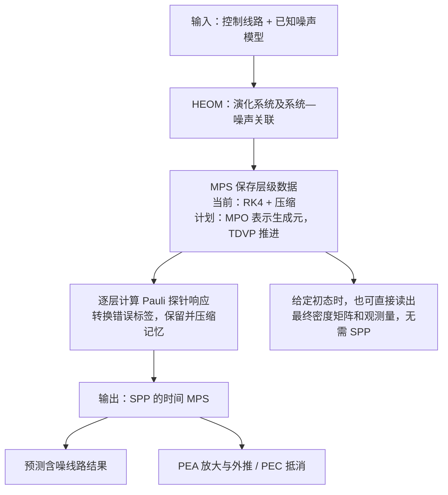

# 从噪声模型到 SPP：我们准备怎么算？

整理：2026-11-16。用于 2026-11-19（周四）讨论，建议主讲 8–10 分钟。阅读起点是[《从 SPL 到 SPP》](spl-to-spp-explainer.md)，不预设已经了解 HEOM 或张量网络传播算法。

本文是基于 `spp_tn` 的流程与任务纲领。已有结果来自此前的合成模拟，本次没有新增实验；文中 MPO + TDVP 的计划状态针对 `spp_tn`。另一个独立的 [`heom_spp_cpu`](../../heom_spp_cpu/README.md) 包已包含 MPO/TDVP 实现，具体计算仍需验证收敛。

## 开场：我们要解决两个问题

SPP（spacetime Pauli process，时空 Pauli 过程）描述各时间层 Pauli 错误的联合概率。设线路有 $n$ 个比特、$L$ 层，第 $j$ 层的错误标签为 $a_j$，每个标签有 $4^n$ 种取值，完整对象为

$$
p(a_1,\ldots,a_L).
$$

它有 $4^{nL}$ 个表项。我们已经知道，直接保存完整表会很贵；但在压缩之前，还有一个问题：**这些概率从哪里来？**

本项目当前选择的是“已知噪声模型 → 动力学计算 → SPP 表示”这条前向路线。因此要同时解决：

1. 如何计算有时间记忆的噪声对控制线路的影响？
2. 如何在构造过程中保留必要的记忆，而不先枚举完整错误历史？

从未知真机数据学习噪声模型是另一项任务，目前没有完成。

## 一张图看完整流程

先认清图中的四个工具：HEOM 是层级运动方程；MPS 是矩阵乘积态形式，用于保存张量数据；MPO 是矩阵乘积算符形式，用于保存线性操作；TDVP 是时间依赖变分原理，用于构造 MPS 的时间演化方法。



不支持 Mermaid 的阅读器可查看[原流程图截图](../figures/heom-spp-workflow-original-20261116.png)。上图在原图基础上明确了两点：HEOM 可以直接预测系统演化；当前传播仍为 RK4，MPO + TDVP 尚在计划中。

## 1. HEOM：没有 SPP，也能计算噪声下的演化

**HEOM（Hierarchical Equations of Motion，层级运动方程）解决的是动力学问题。** 输入控制 Hamiltonian、噪声参数和初态，即可计算系统如何随时间变化，不需要先知道 SPP。

以当前 `spp_tn` 中的经典随机失谐为例，噪声按自己的规律变化，量子系统受到它的驱动，并逐渐与它建立统计关联。这里没有系统对经典噪声源的反作用，所以“共同演化”更准确地说是系统及系统—噪声关联的演化。

只保存平均密度矩阵通常不够。例如，两个实验当前的平均态可以相同，但它们的系统状态与正、负失谐的关联不同，下一段控制后的平均结果便可能不同。

HEOM 为此携带一组矩阵：

$$
X(t)=\Bigl(
\underbrace{\rho_0(t)}_{\text{系统平均态}},\quad
\underbrace{\rho_1(t),\rho_2(t),\ldots}_{\text{辅助层级：比喻中的记忆账本}}
\Bigr).
$$

其中 $\rho_0$ 是平均物理密度矩阵，其余是记录关联的辅助矩阵，并不各自代表归一化的物理态。整个集合满足一组耦合方程。

可以把它想成：**系统状态旁边还带着一本记忆账本。** 一层门结束后，系统平均态和整组辅助矩阵一起传给下一层，只更换控制；不把辅助矩阵清零。否则就人为抹掉了层间关联。

若只想计算某个给定实验的结果，最后读取 $\rho_0(T)$ 即可。对观测量 $O$，其期望值为 $\operatorname{Tr}[O\rho_0(T)]$。SPP 是后面为了表示 Pauli 错误过程、服务预测与缓解而构造的对象。

## 2. 第一种 MPS：把 HEOM 的记忆账本存下来

当前采用的是经典 Gaussian 噪声的 Hermite 层级。多个噪声模式各有自己的层级指标；若有 $K$ 个模式、每个保留 $m$ 级，就有 $m^K$ 种层级组合，还要乘上系统算符的维数。

**MPS（Matrix Product State，矩阵乘积态）**把这个多指标数组拆成一串相连的小张量：

```text
系统算符指标 —— 模式 1 的层级 —— 模式 2 的层级 —— …
```

相邻张量之间的内部指标称为“键”，键的大小称为键维数。控制键维数可以控制存储与计算成本，但会产生需要检查的近似误差。

这里的 MPS 保存的是辅助算符系数，不是普通纯态波函数；不能直接套用量子态的范数归一化或 Born 概率采样。

## 3. MPO + TDVP：怎样推动这本账本演化？

把 HEOM 简写为

$$
\frac{dX(t)}{dt}=\mathcal L(t)X(t),
$$

其中 $X(t)$ 是全部层级数据，$\mathcal L(t)$ 是演化生成元，包含控制、噪声耦合和层级间的信息传递。

| 名称 | 全称 | 在这里负责什么 |
|---|---|---|
| MPS | Matrix Product State | 紧凑保存当前数据 $X(t)$ |
| MPO | Matrix Product Operator | 紧凑表示作用规则 $\mathcal L(t)$ |
| TDVP | Time-Dependent Variational Principle | 在 MPS 的表示能力内近似推进时间 |

MPO 将大算符表示为相连的小张量，每个节点具有输入和输出指标。构造生成元的 MPO，不等于已经得到有限时间传播算符，也不等于已经实现时间积分。

TDVP 则处理“怎样推进”的问题：原方程给出的变化方向可能超出当前 MPS 的表示能力，它在 MPS 的切空间中选择近似变化方向，再通过局部更新和扫描进行演化。相关方法见 [Haegeman et al. 的 TDVP 论文](https://arxiv.org/abs/1408.5056)。

目前代码采用四阶 Runge–Kutta（RK4）加 MPS 压缩。下一步实现 MPO + TDVP 时，需要针对 HEOM 的非幺正线性演化处理局部生成元、键维数和截断，不能直接照搬纯态幺正演化的归一化流程。TDVP 的精度和速度都需要对照验证，不预设它必然更快。

## 4. 从 HEOM 逐层构造第二种 MPS：SPP 时间 MPS

普通 HEOM 计算给定初态的演化。为了构造 SPP，我们改为计算一组 Pauli 探针的线性响应，逐层提取错误过程的信息。探针是计算用的算符基，不要求每个探针都是可直接制备的密度矩阵。

每层的工作是：

1. 从上一层保留的记忆方向出发，计算当前控制层的 Pauli 探针响应。
2. 收缩系统读出指标，保留辅助层级记忆，不在层间重置。
3. 用按 Pauli 对易符号定义的 Walsh 变换，将响应转为错误标签表示。
4. 用奇异值分解（SVD）分离当前时间节点与未来记忆，保留需要的方向，再进入下一层。

最终直接得到

$$
p(a_1,\ldots,a_L)=A_1^{a_1}\cdots A_L^{a_L}.
$$

其中 $A_j^{a_j}$ 是 $\chi_{j-1}\times\chi_j$ 矩阵，两端 $\chi_0=\chi_L=1$。存储系数数目为 $\sum_j4^n\chi_{j-1}\chi_j$。若所需时间键 $\chi_j$ 较小，便能避免完整的指数大表；但一般过程不保证有小键。

此处统一采用 gate-after 约定，将 Pauli 错误放在对应的理想门之后；这是一种错误表示约定，底层动力学仍包含有限门时长内的控制与噪声共同作用。

两种 MPS 必须分清：

```text
HEOM 内部 MPS：系统 —— 噪声模式 1 —— 噪声模式 2 —— …
SPP 时间 MPS：第 1 层错误 —— 第 2 层错误 —— 第 3 层错误 —— …
```

前者压缩辅助层级，后者压缩跨时间错误相关性。前者容易压缩，不自动保证后者容易压缩，反之亦然。

## 5. 得到 SPP 后再做什么？

SPP 可用于计算相关 Pauli 错误对线路观测量的影响。进一步可以做：

- **PEA（Probabilistic Error Amplification，概率误差放大）**：构造更强的噪声，用不同强度的结果外推零噪声值。
- **PEC（Probabilistic Error Cancellation，概率误差抵消）**：构造有符号的修正分布，以加权平均抵消噪声。

当前主线是上游的表示与传播。缓解结果用于检查整条计算链；SPP 易压缩也不保证 PEC 的逆易压缩或采样成本低。

## 6. 已有什么证据，下一步验证什么？

| 环节 | 当前状态 |
|---|---|
| 经典 Hermite HEOM 与层级 MPS | 已实现，采用压缩 RK4 |
| 逐层 HEOM → SPP 时间 MPS | 已有单比特和四比特单模核验 |
| PEA／PEC | 已有单比特完整示例 |
| 显式 MPO + TDVP | 下一阶段任务 |
| CPU 优化／GPU 并行 | 在 MPO + TDVP 正确性与端到端验证后开展 |

此前四比特四层的单模例子，完整表有约 43 亿项，实际输出 MPS 使用 6144 个复数系数，与同层级参考的联合概率 L2 差约 $2.47\times10^{-5}$。但它只有一个 OU 模、3 级记忆空间，不能证明多模、充分收敛后的过程仍有小秩；当前 MPS 路径也没有展示速度优势。完整结果与单比特 PEA／PEC 见[《SPP 太大了，张量网络能帮上忙吗？》](spp-too-big.md)。

接下来的顺序是：

1. 验证 MPO 对层级 MPS 的作用，与原逐项计算及小规模显式矩阵一致。
2. 实现 TDVP，与同层级稀疏指数传播和收敛后的 RK4 对照。
3. 接入 HEOM → SPP，分别检查层级截断、积分步长、内部键与时间键误差，并检查归一化和非负性。
4. 增加模式数和线路长度，再做 CPU 性能分析与 GPU 并行；比较相同精度下的时间和峰值内存。

周四希望讨论的核心问题是：**在指定噪声和控制范围内，达到给定 SPP 精度所需的记忆维数和计算成本，能否随规模增长保持可控？**

## 可直接讲的开场白

> 上次我们讨论的是 SPP 的参数空间太大。这次我想先把计算流程讲清楚：我们从已知噪声模型出发，用 HEOM 携带系统状态和噪声关联，再逐层提取 Pauli 响应，直接构造 SPP 的时间 MPS。这里有两种不同的压缩，一种压缩 HEOM 辅助层级，一种压缩 SPP 时间相关性。目前小规模流程已经跑通，但传播仍是 RK4 加截断。下一步先实现生成元的 MPO 表示和 TDVP 传播，完成精度检查后，再研究 CPU 优化、GPU 并行及扩规模成本。

## 备查：HEOM 为什么需要辅助矩阵？

主讲时可以跳过本节；如果被问到“没有 SPP 时 HEOM 怎样演化”，可以用这个单模例子解释。

取 $\hbar=1$，设 $x(t)$ 是均值为零、平稳方差为 1 的 OU 噪声，相关函数为 $\mathbb E[x(t)x(s)]=e^{-\gamma|t-s|}$，$\gamma$ 为相关性衰减速率。控制 Hamiltonian 为 $H_{\mathrm{ctrl}}(t)$，耦合算符为 $Q$，噪声强度为 $\sigma$。给定一条完整轨迹 $x$，对应系统态 $\rho_x$ 满足

$$
\dot\rho_x=-i[H_{\mathrm{ctrl}}+\sigma xQ,\rho_x].
$$

对轨迹取平均，记 $\rho_0=\mathbb E[\rho_x]$，就有

$$
\dot\rho_0=-i[H_{\mathrm{ctrl}},\rho_0]-i\sigma[Q,\mathbb E[x\rho_x]].
$$

即使 $\mathbb E[x]=0$，也不能把 $\mathbb E[x\rho_x]$ 置零，因为系统与噪声已经相关。引入归一化 Hermite 多项式加权的辅助矩阵，前几项为

$$
\rho_1=\mathbb E[x\rho_x],\qquad
\rho_2=\frac{1}{\sqrt2}\mathbb E[(x^2-1)\rho_x].
$$

对当前单模、无额外耗散的设置，一般第 $k$ 层的方程是

$$
\dot\rho_k=-i[H_{\mathrm{ctrl}},\rho_k]-k\gamma\rho_k
-i\sigma[Q,\sqrt{k}\rho_{k-1}+\sqrt{k+1}\rho_{k+1}],
$$

其中 $k=0$ 时下层项取零。平均态的变化需要一阶关联，一阶关联又耦合二阶关联，从而形成层级。初始系统与平稳噪声独立时，$\rho_0(0)=\rho_{\mathrm{init}}$、$\rho_{k>0}(0)=0$；这表示初始无关联，不表示噪声不存在。演化中高阶矩阵会产生，门边界需保留它们。

实际只保留有限层，需通过增加层级检验收敛。这一解释针对当前 `spp_tn` 的经典 Hermite 层级，不将它与旧量子浴 HEOM 的辅助矩阵逐项等同。

实现依据：[heom.py](../../spp_tn/heom.py)、[process.py](../../spp_tn/process.py)及[包说明](../../spp_tn/README.md)。量子浴 HEOM 携带完整辅助算符继续传播的用法可参见 [QuTiP HEOM 文档](https://qutip.readthedocs.io/en/stable/guide/heom/bosonic.html)。
