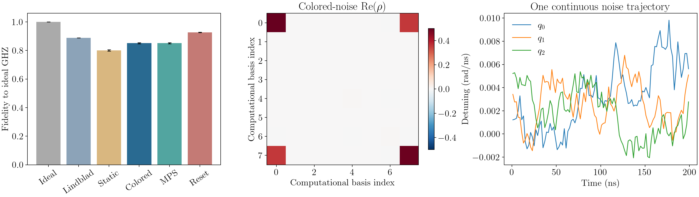

# nmnoise 模拟与复现说明

本文由原 README 的详细使用说明迁入，保留经典轨迹、量子浴及旧基准的模型约定与验证范围。当前 SPP 张量网络实现另见 [spp_tn](../../spp_tn/README.md)。

合作者建议先阅读数值报告中的“读图说明”，再查看研究方案。`results/validated/` 是报告采用的主数据；`results/demo/` 仅保留早期试运行。当前结果是给定模型下的数值验证，尚未对接真机或完成器件噪声学习。



这里已经实现并交叉验证四种求解路线。它们区分两个独立选择：**环境的物理模型**与**演化的数值表示**。

| 路线 | 环境模型 | 数值表示 | 当前示例 |
|---|---|---|---|
| dense trajectories | 经典 Gaussian 有色噪声 | 系统态矢量、逐时间格完整矩阵指数 | 3 比特有限时长 GHZ 电路 |
| MPS trajectories | 与 dense 完全相同的噪声轨迹 | 真正的空间 MPS，局部门与 SVD | 与 dense 逐样本对照 |
| HEOM | 热平衡量子谐振子浴 | 系统密度矩阵及辅助密度算符 ADO | 单比特门序列、两个浴模 |
| explicit bath | 与 HEOM 完全相同的浴 | 系统与截断谐振子联合密度矩阵 | 对 HEOM 独立验证 |

另外提供静态失谐、连续 Lindblad 以及每个脉冲后重置环境的诊断对照。

**下述旧 `nmnoise` 模拟没有实现 HEOM 层级的 MPS 压缩或 TEMPO。** 其中的 MPS 压缩系统态，环境记忆由持续的随机轨迹保存。新 `spp_tn` 包另行实现经典 Hermite 层级的 MPS 与 SPP 时间 MPS；它不改变旧量子浴示例的实现。论文中的 MPS-HEOM 压缩辅助层级，TEMPO / process tensor 可压缩时间方向的影响泛函，不能混称。

### 运行

首次使用创建项目专用 conda 环境（Python 3.11，依赖版本已固定）：

```bash
git clone https://github.com/Qubit-Fernand/non-markovian-noise.git
cd non-markovian-noise
conda env create -f environment.yml
conda activate TensorCircuitNG
python -m pytest -q
```

也可以先自行准备 **Python 3.11** 的干净环境，再使用标准 pip 入口：

```bash
python -m pip install -r requirements.txt
python -m pip check
python -m pytest -q
python -m spp_tn.demo --output results/my_spp_run --convergence
```

[`requirements.txt`](../../requirements.txt) 固定了 TensorCircuit-NG 1.10.0、NumPy 2.4.6、SciPy 1.15.2、QuTiP 5.2.2 等经过验证的版本，并以 editable 方式安装本仓库。`environment.yml` 复用同一文件，避免两套版本漂移。不要在同一环境中同时安装 `tensorcircuit` 与 `tensorcircuit-ng`。核心求解器和测试无需系统 LaTeX；生成论文风格图表时才需要安装 LaTeX 和字体。macOS ARM 已本地验证；Linux 等其他平台尚未验证，跨平台允许浮点舍入差异。

查看已有报告、PNG 图和结果数据无需重跑。生成新图前需要安装系统 LaTeX 和 Times New Roman 字体；绘图配置位于 `run_demo.py` 的 `make_plot()`。快速试运行和完整运行分别为：

```bash
python run_demo.py --samples 32 --skip-quantum --output results/quickstart
python run_demo.py --samples 2048 --output results/reproduced
```

本机已有 `TensorCircuitNG` conda 环境，可直接运行：

```bash
conda run -n TensorCircuitNG python run_demo.py --samples 2048 --output results/my_run
conda run -n TensorCircuitNG python -m pytest -q
```

默认运行 3 比特；`--qubits 4` 改为 4 比特，`--dt 1` 减小时间步长，`--sigma 0.002` 改变失谐标准差。`--skip-quantum` 仅跳过量子浴示例。每次选择一个新的 `--output` 目录，脚本不会覆盖已有 `summary.json`。

依赖范围见 `pyproject.toml`，固定安装版本统一见 `requirements.txt`；各次归档运行的版本见结果记录及 Git 历史。核心求解器不依赖 LaTeX。输出图中的误差棒为轨迹 Monte Carlo 的一个标准误，不是硬件 shots 的误差。

输出包括：

- `summary.json`：参数、版本、终态指标、误差与运行时间。
- `final_states.npz`：各经典噪声模型的完整复数终态密度矩阵。
- `quantum_states.npz`：量子浴各解法在初始时刻及每个脉冲末的密度矩阵。
- `colored_noise.npy`：dense 与 MPS 共用的完整随机轨迹。
- `comparison.png`：结果对照、终态矩阵实部、一条连续噪声样本。

JSON 中的时间是单次端到端计时，可能包含首次导入和缓存开销，不能直接用于宣称某个算法更快。

读取完整终态：

```python
import numpy as np
rho = np.load("results/my_run/final_states.npz")["colored_dense"]
print(rho)
print(np.diag(rho).real)
```

### 经典有色噪声例子

采用 hbar=1，时间单位 ns，Hamiltonian 系数及失谐单位 rad/ns。第 0 个比特是最左边的 tensor factor，计算基排列为 `000,001,...,111`。

系统从 `|000>` 出发，控制顺序为：

1. 第 0 比特 `Ry(pi/2)`，20 ns。
2. `CX(0,1)`，80 ns。
3. `CX(1,2)`，80 ns。
4. 等待，20 ns。

理想结果为 `(|000>+|111>)/sqrt(2)`。这里 CNOT 用可直接验证的理想控制 Hamiltonian 实现，不是器件拟合的 CR 门：

$$
H_{CX}=\frac{\pi}{\tau} |1\rangle\langle1|\otimes\frac{I-X}{2}.
$$

整个脉冲期间同时作用

$$
H(t)=H_{\mathrm{ctrl}}(t)+\frac12\sum_i\xi_i(t)Z_i.
$$

因此噪声不是等门结束以后才加上去。dense 每个时间格直接指数化总 Hamiltonian。MPS 采用 Strang 分裂 `noise(h/2) -> control(h) -> noise(h/2)`；这只是一个随 h 收敛的数值积分方法，不是物理上假设门和噪声分离或在门间重置环境。

#### 有记忆的噪声如何产生

每个比特的噪声独立，由 K=12 个平稳 Ornstein-Uhlenbeck 过程相加：

$$
C_\xi(t)=\frac{\sigma^2}{K}\sum_k e^{-\gamma_k|t|},\qquad
S_\xi(\omega)=\frac{\sigma^2}{K}\sum_k\frac{2\gamma_k}{\gamma_k^2+\omega^2}.
$$

定义 `C(t)=integral S(omega) exp(-i omega t) d omega/(2*pi)`。默认 `sigma=0.004 rad/ns`，`gamma_k` 在 `[1e-4,0.1] ns^-1` 上对数均匀。等权重对数分布的 Lorentzian 之和只在频带内部近似 `1/|omega|`；低频趋于常数，高频按 `1/omega^2` 衰减，方差有限。它不是无截止的严格 `1/f`，也不是原论文量子谱的原样实现。

每次执行都保存同一条噪声轨迹直到电路结束；系统门不会重采样环境。输出的混态是

$$
\rho(T)\approx\frac1M\sum_r|\psi_r(T)\rangle\langle\psi_r(T)|,
$$

不是先平均态矢量再取外积。轨迹平均不等于真实实验里每个 shot 都独立重新采样慢噪声；研究跨 shot 漂移还需要单独的采集时间模型。

这里“有记忆”指时间相关性及跨门历史的保留；代码没有将它与 CP-indivisibility 或某个特定 non-Markovianity witness 等同，也没有计算这些判据。

#### 对照的含义

- quasi-static：每个比特每条电路采样一个固定失谐，与有色模型匹配瞬时方差。
- reset：每个脉冲边界重新采样平稳环境，是人为切断记忆的消融实验，不是默认物理假设。
- Lindblad：控制和耗散同时演化，单比特自由相干度为 `exp(-gamma_phi*t)`。用有色模型在 100 ns 的 Ramsey 相干度校准这个单一速率。它不是多数据拟合得到的最优 Markovian 模型。

这些对照用于演示“不同物理假设会给出不同终态”，并不证明某个模型更符合实际硬件，也不把噪声变小与模型更准确混为一谈。

### 量子浴例子

为了真正包含量子环境及反作用，而不仅是经典随机 Hamiltonian，另一个例子演化

$$
H_{\mathrm{tot}}(t)=H_{\mathrm{ctrl}}(t)+\sum_k\omega_k a_k^\dagger a_k
+\frac Z2\sum_k g_k(a_k+a_k^\dagger).
$$

系统初态 `|0>`，浴初态为独立 Gibbs 态，初始系统与浴因子化。采用 `Ry(pi/2)`、等待、`Rx(pi/2)`、等待，各 10 ns。浴相关函数为

$$
C_B(t)=\sum_k g_k^2[(n_k+1)e^{-i\omega_k t}+n_k e^{i\omega_k t}],\qquad
n_k=(e^{\beta\omega_k}-1)^{-1}.
$$

这个相关函数包含虚部与正负频率不对称。经典实 Gaussian 噪声不能一般地重现它。

`mode_parameters()` 用有限频带上的对数中点求积，离散化对称谱 `1/|omega|`，每个对数频率格分配相同方差。默认频带为 `[0.015,0.24] rad/ns`，两个中点频率为 `[0.03,0.12] rad/ns`，`sigma=0.03 rad/ns`、`beta=60 ns`。这是一组方便独立数值核验的参数，**不是论文的 50 mK 参数或实际器件参数**。

- HEOM 用 QuTiP 的 `BosonicBath` 和 `HEOMSolver`；每次更换脉冲 Hamiltonian 时，继续传递完整 ADO 状态。
- 显式浴将谐振子截断到有限 Fock 空间，直接演化联合密度矩阵，再对浴求偏迹。
- 运行比较 HEOM 深度 4/6、Fock 截断 5/7，并报告终态 trace distance。
- 两个振子只是粗离散模型，会有有限模回归效应。即使 HEOM 与显式浴完全一致，也不证明已收敛到连续 `1/f` 环境。

增加 `modes` 会快速增加 HEOM ADO 数量，显式浴维数也按 `2*fock**modes` 增长。代码设有资源上限，避免误触非常大的计算。温度升高后显式 Fock 截断可能要大很多；此时它通常只适合作为小模型基准。

### 修改初态与控制

`Pulse` 包含名称、持续时间、作用位点和局域 Hamiltonian。经典 dense/MPS 支持一比特与相邻两比特的分段常数控制、一般纯初态；支持任意位点的门或多个同时局域控制项需要扩展当前接口。初态应归一化。量子浴接口支持单比特密度矩阵初态。

```python
from nmnoise.core import ghz_schedule, ensemble_rho
from nmnoise.classical import ou_noise, dense_trajectories
from nmnoise.mps import mps_trajectories

pulses = ghz_schedule(4)
noise = ou_noise(pulses, n=4, dt=2, samples=256, sigma=0.004, seed=7)
states = dense_trajectories(pulses, noise, dt=2)
rho = ensemble_rho(states)
states_mps, diagnostics = mps_trajectories(pulses, noise, dt=2, substeps=2)
```

MPS 可以指定 `max_bond` 与 `svd_cutoff`，记录丢弃权重及归一化偏差。当前为方便比较，会在终点还原完整态矢量并输出完整密度矩阵，所以它是小系统验证原型，不是已经完成可扩展输出的多比特仿真平台。真正扩规模时需要直接收缩局域观测量，避免还原指数大小的终态。

### 误差检查

测试覆盖：无噪声 GHZ、任意纠缠初态的 MPS 对照、Strang 步长收敛、MPS 截断报告、OU Ramsey 解析解、Lindblad 相干衰减率、HEOM 与独立显式浴、HEOM 解析退相干以及人工门边界不应改变连续演化。

需要分开看四类误差：

1. 随机轨迹有限样本误差。
2. 时间格和 MPS 分裂误差。
3. HEOM 层级与显式浴 Fock 截断误差。
4. 谱模型和频率离散误差，以及与真实硬件之间的模型误差。

`paired_grid_refinement` 用同一条细网格轨迹及相邻时间格平均得到的粗轨迹，检验格内时间顺序误差；不能将其单独解释成所有连续噪声离散误差的完整上界。

### 依据与后续扩展

- 原始参考论文：Chen et al., [arXiv:2509.07693v2](https://arxiv.org/abs/2509.07693v2)，已收入 [Zotero 群组条目](https://www.zotero.org/groups/6729418/items/AXEGG4GX)。目前复用了其“有限时长控制 + 有记忆环境”的问题设置，没有宣称复现其全部参数与 BSD/MPS-HEOM 计算。
- [QuTiP Bosonic HEOM 文档](https://qutip.readthedocs.io/en/v5.1.0/guide/heom/bosonic.html)：量子浴相关函数的指数展开、时间依赖控制和 ADO。
- [OQuPy PT-TEMPO 教程](https://oqupy.readthedocs.io/en/latest/pages/tutorials/pt_tempo.html)：时间方向张量网络的另一条实现路线，当前未安装、未实现。

下一步应选择具体器件/论文参数，统一谱归一化、温度和截止约定，拟合浴相关函数，然后做连续谱与层级的收敛检查；再扩展到两比特 CR 控制。当前代码已经可作为这些工作的可检验起点。

### 当前研究进展

配对脉冲扫描及[受限四比特 Ising SPP/PEC 基准](spp-ising-benchmark.md)已完成，均为合成数值实验。新基准只覆盖两时段 I/Z 历史、单站点单模浴及瞬时理想 Ising 控制，未实现通用 SPP 学习或真机验证。合作者报告的 HEOM → SPP → PEC 近期进展及 IBM 文献理解修正，见 [2026-10-28 讨论记录](paired-pulse-proposal.md#讨论更新heom--spp--pec-与-ibm-文献复核2026-10-28-整理)；合作者源码、参数和优化算法仍待取得并核对。IBM 文献已完成[专项核对](ibm-2607-25998-review.md)：用于 PEC 的仍是 SPL，但 F.2 额外拟合了准静态相关模型以评估残余偏差。实验设计、结果及未决事项统一维护在 [proposal 文档](paired-pulse-proposal.md)。

新基准复现（输出目录必须不存在）：

```bash
conda run -n TensorCircuitNG python run_spp_benchmark.py --output results/spp_ising_reproduced
conda run -n TensorCircuitNG python -m pytest -q
```

主记录：[results/spp_ising_20261029/summary.json](../../results/spp_ising_20261029/summary.json)。12 条留出电路、84 个观测量的预测 RMSE 为独立层 0.005545、相关模型 0.000306；相关 PEC 的准概率开销因子 $\gamma^2=2.4891$。默认训练 300,000 shots、每目标 PEC 20,000 shots；100 次重复学习计入有限学习误差。完整限定及成本见报告。
