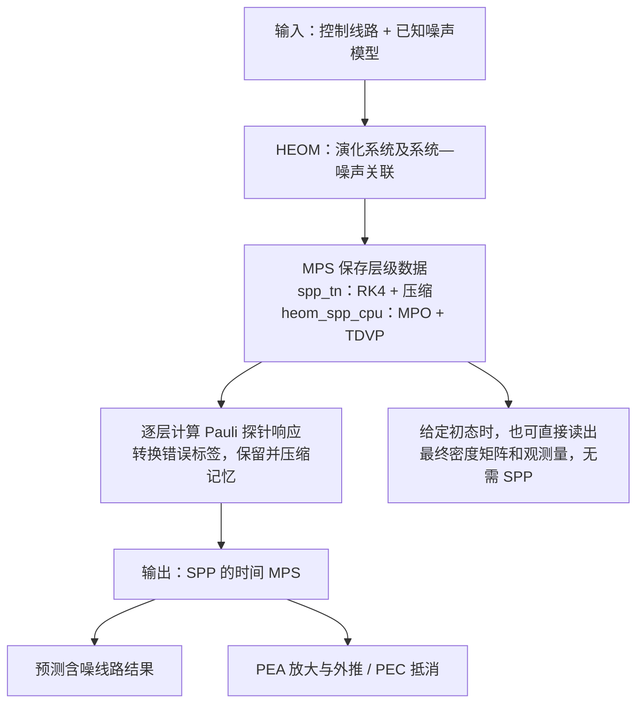

# 从噪声模型到 SPP：我们怎么算？

本项目研究有限时长控制下的时间相关噪声。当前主线是：输入已知噪声模型，用 HEOM 计算动力学，在计算过程中直接构造 SPP 的时间张量网络，再用于预测与误差缓解。以下按流程图展开，可作为组会的 8–10 分钟纲领。

实现状态更新于 2026-11-19；数值证据见 [experiments.md](experiments.md)，后续任务见 [research.md](research.md)，运行方法见 [usage.md](usage.md)。目前证据均来自合成模拟，没有真机噪声学习或硬件验证。

## 一张图看完整流程

先认清四个名称：HEOM 是层级运动方程；MPS 是矩阵乘积态形式，用于保存多指标数据；MPO 是矩阵乘积算符形式，用于表示线性操作；TDVP 是时间依赖变分原理，用于构造 MPS 的演化方法。



保留的[原流程图截图](figures/heom-spp-workflow-original-20261116.png)记录了当时的讨论，其中“计划用 MPO”属于历史状态。上面的 Mermaid 是当前维护版本：独立包 `heom_spp_cpu` 已有 MPO／TDVP，仍需针对目标模型验证收敛；`spp_tn` 保留 RK4 参考路径。

## 0. 输入：控制线路与噪声模型

需要给定初态、理想线路与层划分、每层实际控制的 Hamiltonian 和时长，以及噪声的耦合算符、强度与相关函数。有限脉冲期间，控制和噪声同时作用。

目前最容易核验的对象是经典高斯噪声：静态失谐、Ornstein–Uhlenbeck（OU）噪声及其多个模式的组合。OU 模式的相关性随时间指数衰减。真实器件的谱、控制波形和噪声参数如何获得，属于后续测控与学习工作；已知模型的前向计算不能替代这一步。

为什么最终想要 SPP？单层稀疏 Pauli–Lindblad（SPL）模型描述一层噪声；跨层独立时，可以把各层错误概率相乘。时空 Pauli 过程（SPP）则描述整条错误历史的联合概率：

$$
p(a_1,\ldots,a_L),\qquad a_j\in\{I,X,Y,Z\}^{\otimes n}.
$$

这里 $n$ 是比特数，$L$ 是时间层数，$a_j$ 是第 $j$ 层的 Pauli 错误标签。同样的单层边缘概率，可以对应不同的跨层相关性。一般 SPP 有 $4^{nL}$ 个表项；张量网络希望避免先生成这张完整大表。手算例子保留在[从 SPL 到 SPP](archive/spl-to-spp-explainer.md)。

## 1. HEOM：携带系统状态及噪声记忆

**HEOM（Hierarchical Equations of Motion，层级运动方程）负责动力学。** 它不依赖 SPP，也能计算给定初态在噪声下如何演化。

只保存平均密度矩阵通常不够：两个实验当前的平均态可以相同，但系统状态与失谐的关联不同，下一段控制后的结果也会不同。HEOM 为此携带一组辅助密度算符（ADO，Auxiliary Density Operator）：

$$
X(t)=\bigl(\rho_0(t),\rho_1(t),\rho_2(t),\ldots\bigr).
$$

$\rho_0$ 是系统平均态，其余矩阵记录系统与噪声的关联，并不是各自归一化的物理态。可把它们理解成系统旁边的“记忆账本”。层间只更换控制，整组辅助矩阵继续传播；把它们清零会人为抹掉记忆。

这里的经典噪声按自身规律变化，没有系统对噪声源的反作用。因此“共同演化”指系统及系统—噪声关联的演化，并非显式模拟完整量子环境。旧 `nmnoise` 的量子浴 HEOM 是另一种模型。

若只想预测一个给定实验，最后读取 $\rho_0(T)$ 即可；对观测量 $O$，期望值为 $\operatorname{Tr}[O\rho_0(T)]$。流程图中绕开 SPP 的分支就是这个用途。

## 2. 层级 MPS：保存记忆账本

当前经典高斯模型使用 Hermite 层级。若有 $K$ 个噪声模式，每个保留 $m$ 级，层级组合已有 $m^K$ 种，还要乘上系统算符空间的维数。

**MPS（Matrix Product State，矩阵乘积态）**把这个多指标数组拆成一串小张量：

```text
系统算符指标 —— 模式 1 的层级 —— 模式 2 的层级 —— …
```

连接张量的内部指标称为“键”，大小称为键维数。限制键维数可以降低成本，同时引入截断误差。这里保存的是线性算符系数，不能套用纯态波函数的自动范数归一化或 Born 概率采样。

## 3. MPO + TDVP：推进层级数据

将全部层级方程写成

$$
\frac{dX(t)}{dt}=\mathcal L(t)X(t),
$$

其中 $\mathcal L(t)$ 是包含控制、噪声耦合和层级间传递的演化生成元。

| 工具 | 全称 | 本项目中的职责 |
|---|---|---|
| MPS | Matrix Product State | 保存层级数据 $X(t)$ |
| MPO | Matrix Product Operator | 用张量链表示生成元 $\mathcal L(t)$ |
| TDVP | Time-Dependent Variational Principle | 在 MPS 切空间内近似推进时间 |

MPO 的每个节点都有输入和输出指标。它表示“怎么作用”，不等于已经计算出有限时间传播算符，更不是 PEA 或 PEC 的求逆。

TDVP 处理“怎么推进”：真实方程的变化方向可能超出当前 MPS 的表示能力，因此投影到 MPS 切空间，再用局部更新与扫描实现演化。HEOM 是非幺正线性演化，必须保留正确的尺度，不能照搬量子纯态归一化。

两条已有实现分别是：

- [`spp_tn`](../spp_tn/README.md)：局域乘积算符求和，四阶 Runge–Kutta（RK4）推进并压缩；使用 TensorCircuit-NG 的 NumPy 后端。
- [`heom_spp_cpu`](../heom_spp_cpu/README.md)：显式 MPO、单站点 KSL／TDVP、非厄米 Arnoldi 局部求解；另有 RK4 和稀疏指数参考引擎，使用 NumPy／SciPy。

当前重点是验证现有 MPO／TDVP 路径在目标模型中的精度、键维数和收敛性，再扩展 CPU 性能分析与 GPU 并行。已有局部 CPU 优化记录，但没有 GPU 实现；TDVP 也不保证在小问题上更快。

## 4. Pauli 响应：逐层提取错误与记忆

普通 HEOM 推进给定初态。构造 SPP 时，改为推进一组 Pauli 算符探针；探针是线性基，不要求每个探针都能直接作为密度矩阵制备。

1. 固定本层理想门 $U_j$，从上一层保留的记忆方向出发，传播输入探针 $U_j^\dagger P_bU_j$；$P_b$ 是 Pauli 基中的第 $b$ 个算符。
2. 对系统腿作 $\operatorname{Tr}(P_b\,\cdot)/d$ 读出，$d=2^n$，保留辅助层级记忆腿。
3. 用按 Pauli 对易符号定义的 Walsh 变换，从响应转为错误标签表示。
4. 用奇异值分解（SVD）分离当前时间节点与未来记忆，截断并记录误差，再进入下一层；最后才关闭根 ADO。

本项目采用 **gate-after**：错误标签放在对应理想门之后。这只是表示约定，底层传播仍包含有限脉冲内的控制与噪声共同作用。归档 HTML 中的门前图示不能直接代入此约定。

## 5. 输出：SPP 的时间 MPS

逐层构造直接得到

$$
p(a_1,\ldots,a_L)=A_1^{a_1}A_2^{a_2}\cdots A_L^{a_L},
$$

其中 $A_j^{a_j}$ 为 $\chi_{j-1}\times\chi_j$ 矩阵，边界 $\chi_0=\chi_L=1$。存储量从完整表的 $4^{nL}$ 项变成 $\sum_j4^n\chi_{j-1}\chi_j$ 个系数，收益取决于达到所需精度时的时间键维数 $\chi_j$。

| 表示 | 节点代表什么 | 压缩什么 |
|---|---|---|
| HEOM 内部 MPS | 系统算符、各噪声模式层级 | 辅助层级组合 |
| SPP 时间 MPS | 各层 Pauli 错误 | 跨时间错误关联 |
| 旧轨迹模拟的空间 MPS | 各量子比特 | 单条轨迹的空间态 |

前两种 MPS 的压缩难度没有自动对应关系。时间压缩也没有消除每层 $4^n$ 个错误标签或系统腿的空间指数成本。一般过程不保证低秩，归一化正确也不保证截断后的全历史概率非负。

## 6. 下游：预测、PEA 和 PEC

得到 SPP 后，可与理想线路的响应收缩，预测逐层 Pauli twirling 后的含噪观测量。它并不自动等于未 twirl 的原始相干噪声线路结果。

- **PEA（Probabilistic Error Amplification，概率误差放大）**：加入可控的额外 Pauli 噪声，比较不同增益，再外推零噪声值。
- **PEC（Probabilistic Error Cancellation，概率误差抵消）**：求有符号修正分布 $q$，按绝对权重采样并加权平均；采样成本由 $\Gamma=\sum|q|$ 控制，通常按 $\Gamma^2$ 放大。

已有单比特 PEA 和 PEC 示例，两者都是流程的下游。SPP 易压缩不保证其逆易压缩、逆存在或 $\Gamma$ 较小。模型学习误差、有噪声的 twirling／修正操作和硬件实施仍需单独研究。

## 组会可以这样开场

> 上次的问题是 SPP 参数空间太大，这次先讲这些参数从哪里来、如何避免完整枚举。我们从控制和已知噪声模型出发，用 HEOM 携带系统状态与噪声记忆；MPS 保存层级数据，MPO 表示演化规则，TDVP 推进时间。随后逐层提取 Pauli 响应，直接得到 SPP 的时间 MPS，再用于预测、PEA 和 PEC。目前小规模构造及缓解已有结果，独立 CPU 包也已有 MPO／TDVP；下一步要验证目标模型的收敛，考察达到同样精度所需的键维数和成本，再推进并行优化。

## 备查：一个 OU 模式的 HEOM

取 $\hbar=1$。令 $x(t)$ 为均值零、平稳方差一的 OU 噪声，$\mathbb E[x(t)x(s)]=e^{-\gamma|t-s|}$；$\gamma$ 为相关性衰减速率，$H_{\rm ctrl}$ 为控制 Hamiltonian，$Q$ 为耦合算符，$\sigma$ 为强度。给定轨迹的系统态 $\rho_x$ 满足

$$
\dot\rho_x=-i[H_{\rm ctrl}+\sigma xQ,\rho_x].
$$

取平均后 $\rho_0=\mathbb E[\rho_x]$ 的变化依赖 $\mathbb E[x\rho_x]$，即使 $\mathbb E[x]=0$，这一关联也不能忽略。引入概率论 Hermite 多项式 $\mathrm{He}_k$，定义 $\rho_k=\mathbb E[\mathrm{He}_k(x)\rho_x]/\sqrt{k!}$，得到

$$
\dot\rho_k=-i[H_{\rm ctrl},\rho_k]-k\gamma\rho_k
-i\sigma[Q,\sqrt{k}\rho_{k-1}+\sqrt{k+1}\rho_{k+1}].
$$

$k=0$ 时下层项为零。初始系统与平稳噪声独立时，高阶辅助矩阵为零；演化会产生这些关联，门边界必须保留。实际保留有限层，需要增加层数检查收敛。此例解释经典 Hermite 层级，不把它与量子浴 HEOM 的辅助矩阵逐项等同。

实现依据：[spp_tn/heom.py](../spp_tn/heom.py)、[process.py](../spp_tn/process.py)、[CPU TDVP](../heom_spp_cpu/heom_spp/tdvp.py)。理论背景见 [TDVP](https://arxiv.org/abs/1408.5056) 和 [QuTiP HEOM 文档](https://qutip.readthedocs.io/en/stable/guide/heom/bosonic.html)。
