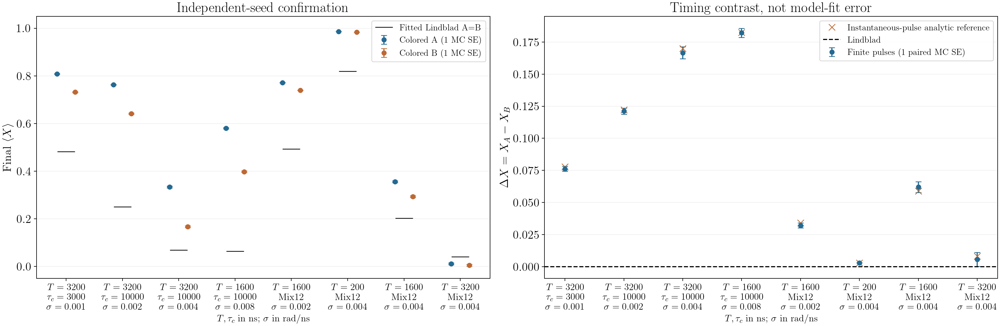
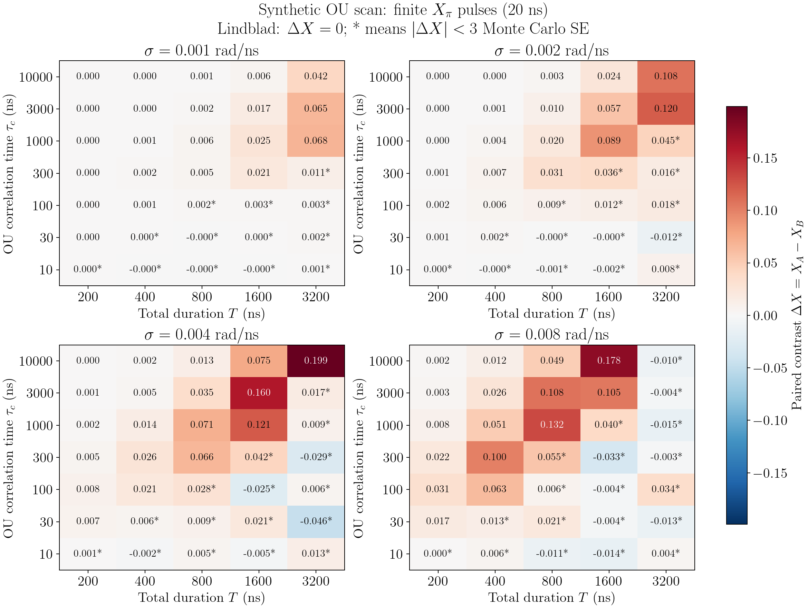

# 首要研究 proposal：真机能否分辨时间记忆（2026-10-15）

**核心问题：有限时长控制下，时间相关噪声何时使校准后的 Lindblad 模型失去预测能力？能否用少量专门设计的实验找到这个边界，并预测未参与拟合的电路？** 这是按 xiaoyang 学长建议确定的优先研究方向，尚非已证实的 non-Markovian effect。实验条件已确认：实验室可直接控制微波脉冲。

## 合作者新方案：学习时空 Pauli 过程并用于预测与缓解（2026-10-21）

**方案来源与状态**：根据本次提供的群聊截图整理；用户说明该方向已得到老师肯定。以下先记录合作者提出的路线，再列本项目的推进建议，后者尚待共同讨论。截图顶部被截断，不能完整还原首篇链接；下文补充核对了与 SPP 描述相符的文献。当前仓库尚未实现 SPP 学习、多时刻 twirling 或基于它们的误差缓解，也没有相应真机结果。

### 合作者提出的四步路线

这里的 **SPP（spatiotemporal Pauli process，时空 Pauli 过程）**描述多个噪声时段中 Pauli 错误的联合分布；**SPL（sparse Pauli-Lindblad，稀疏 Pauli–Lindblad）**是用于比较和学习的噪声模型。设系统有 $N$ 个比特、$L$ 个噪声时段，每段的错误标签为 $P_\ell\in\{I,X,Y,Z\}^{\otimes N}$。不施加结构假设时，联合表 $p(P_1,\ldots,P_L)$ 有 $4^{NL}$ 个条目，因此压缩和可辨识性都是核心问题。

| 步骤 | 合作者的设想 | 需要交付的对象 |
|---|---|---|
| 1. 已知 SPP 后的学习 | 从联合概率学习 SPL，参考原有 Pauli 噪声学习技术，并引入张量网络直接计算 | 说明保留了哪些边缘量、丢失了哪些时间相关，以及拟合残差 |
| 2. 物理模拟到 SPP | 从真实噪声动力学及 Pauli twirling 构造 SPP；按器件情况取舍噪声源，评估 HEOM 成本和有限 twirl 样本误差 | 小系统可验证的 SPP 或可收缩的表示，与测量概率预测 |
| 3. 实验数据到 SPP | 改造已有 IBM/本组实验流程，考虑随机测量等工具 | 明确的控制、测量协议和统计推断方法，而非直接假定已获得错误标签 |
| 4. 学到噪声后的缓解 | 借鉴张量网络方法，探索 PEC（概率误差抵消）或 ZNE（零噪声外推） | 在计入学习成本后仍能改善留出电路估计的证据 |

截图提到需了解 CNOT 的具体实现、虚拟 Z 门、残余耦合以及可能的准粒子/TLS 等噪声源。这里将它们记为**待器件团队确认的候选因素**，不认为当前设备已测得这些机制，也不预设必须为每种因素配置一个独立量子浴。

### 与现有配对脉冲方案的关系

两条路线围绕同一个问题：**跨门时间相关是否需要进入预测模型？** 配对脉冲是成本较低的模型筛选实验；SPP 路线进一步研究如何学习和压缩相关结构，再用于预测或缓解。建议保留前者作为前期诊断，同时为后者单独设计测量协议。

尤其要区分原始有限脉冲电路和经过随机化的电路：twirling 会改变被研究的过程，不能假定原来的 $\Delta X$ 信号及大小在 twirling 后不变。应分别模拟并测量两者；既有配对扫描只适用于原先定义的控制与噪声模型。

### 建议先澄清的三个技术问题

**1. 从多时刻过程出发，不能只保留终态通道。** Pauli transfer matrix（PTM，Pauli 转移矩阵）通常表示单个通道；process tensor（过程张量）则描述系统在多个时刻接受干预后的响应。单个电路末态的 PTM 一般不足以确定跨层联合分布。若截图中的 PTM 是多时刻对象的 Pauli 表示，应在实现前明确其输入输出指标。步骤 2 应保留可插入控制的时间接口，再按所选协议做多时刻 twirl。仅把逐层边缘通道做 twirl 后相乘，会先丢掉希望研究的相关性。

**2. “SPP → SPL”适合作为基线投影，不是一般的等价转换。** 独立层近似可写为

$$
p_{\mathrm{ind}}(P_1,\ldots,P_L)=\prod_{\ell=1}^L p_\ell(P_\ell).
$$

它保留单层错误率，却不保留时间相关。进一步把各层写成 SPL 还施加稀疏生成元等限制，任意 Pauli 通道也不保证可由所选非负速率 SPL 精确表示。因此，建议同时比较“独立 Pauli 层”“SPL 层模型”“具有记忆的联合模型”，分别量化生成元限制和忽略时间相关带来的误差。不要只评估 SPL 参数是否拟合成功。

**3. 压缩表示不等于可以从现有测量中学到。** 实验直接得到的是控制设置 $s$ 下的读出 $b$，不是隐藏的 $P_1,\ldots,P_L$。在选定、有效的随机化过程模型下，可考虑直接拟合

$$
p_\theta(b\mid s)=\sum_{\boldsymbol P}
 p_\theta(\boldsymbol P)\,p(b\mid s,\boldsymbol P),
\qquad \boldsymbol P=(P_1,\ldots,P_L),
$$

其中 $\theta$ 是待学模型参数；右侧的响应还需纳入控制、制备与读出误差。该式要求不同设置共享同一过程定义；若更换物理门会改变噪声，应使用明确的控制依赖模型，不能直接复用同一 $p_\theta$。先在小系统构造响应矩阵，检查秩或参数 Jacobian，寻找产生相同测量概率的不同模型。如果不能辨识完整联合分布，就改为学习可辨识的相关量或预测等价类。普通末态 classical shadows 不自动提供跨时间的完整信息；中途测量、重制备或辅助比特是否可用，需要另行确认，微波脉冲控制权限本身并不保证这些能力。

### 推荐的最小实验：先证明能识别时间相关，再追求完整学习

**第一阶段：一比特、两个时段的受控正对照。** 通过微波控制主动注入 Pauli $Z$ 错误，设置两组每段错误率都为 $p$ 的序列：

- 独立组：两个时段分别独立选择 $I/Z$。
- 相关组：一次运行内共用同一个随机位，以概率 $p$ 两段都施加 $Z$，否则都施加 $I$。

在理想的恒等演化、初态 $|+\rangle$、最终测量 $X$ 的示例中，相关组因 $ZZ=I$ 给出 $\langle X\rangle=1$，独立组给出 $(1-2p)^2$；取 $p=0.05$ 时，两者相差 $0.19$。这是直接计算的设计示例，**不是已运行模拟或实验结果**。另用单时段序列检验两组边缘错误率一致。注入的 $Z$ 必须相对于固定的目标电路和读出基定义；若用虚拟 Z 实现，需检查编译与帧跟踪没有把它作为已知修正自动抵消，并校准实际注入操作。这个例子能检查实验链路是否保留并识别“同样边缘、不同联合”的差异；它是人为注入的经典相关噪声，不能据此声称观察到器件自身的非马尔可夫效应。

**第二阶段：从已知注入转向未知器件噪声。** 先使用一比特、2–4 个时段的固定控制块，变化间隔和总时长，安排准备/测量基与必要的中间控制。在小系统上先做完整联合表或可辨识部分的参考计算，再尝试 2、4、8 个隐藏状态的 HMM（隐马尔可夫模型），以留出预测选择复杂度。HMM 是保证非负性和归一化的一种候选模型，不等同于任意量子环境。若能力允许，再加入中间测量—重制备设置，检查是否减少不可辨识性。

为使比较公平，加入独立层、准静态漂移和短记忆模型；尽量匹配其单时段数据，冻结参数后预测新间隔、新排列及未参与训练的深度。随机交错不同设置，保存时间戳、实际波形、随机帧/注入标签及原始计数，按独立实验时间块划分训练与测试。原始标签用于审计；分析前明确模型是否允许利用这些标签，避免把仅模拟或注入实验中可见的隐藏信息泄漏给学习器。

**第三阶段：两比特，再到四比特。** 加入一种已校准的纠缠门和少量耦合项，分别测试空间相关与时间相关。先用现有连续有色轨迹生成数据；只在数据要求量子浴描述时调用 HEOM/显式环境作为小系统基准。当前模拟器能生成控制下的末态样本，但还需新增多时刻接口、随机化协议和观测响应，才能承担 SPP 数据生成，不能直接把现有 Bloch 样本当作 SPP 样本。

### 张量网络与误差缓解的具体切入点

- **先以能预测的最小记忆模型为目标**：一比特四时段只有 $4^4=256$ 个联合条目，适合建立枚举参考；这里的条目数不等于所需 shots。之后才研究时间方向的 MPS/MPO 压缩，并以概率非负性、归一化、留出似然和压缩误差验证。现有系统态 MPS 求解器不是这个时间方向的概率模型。
- **不要把低键维度当成已成立的物理结论**：逐渐增大键维度或隐藏状态数，检查预测是否收敛。普通 SVD 截断不自动保持概率非负；有限维 HMM 是受限的实现选择，不能无条件覆盖一般 SPP。拟合优度、样本成本和收缩成本需要分别报告。
- **分别估计两类抽样误差**：用 $R$ 个独立随机帧，每帧 $n$ 次测量，总预算 $Rn$。先通过 pilot 估计帧间方差与帧内测量方差，再分配预算；按帧及时间块重采样，而不是将所有 shots 当作独立同分布样本。增大单帧 shots 不能消除有限帧平均误差。
- **缓解作为第二个里程碑**：先要求记忆模型提高未见电路的预测，再在小电路上比较未缓解、独立层缓解与联合模型缓解。统计总均方误差（偏差平方加方差），计入训练和校准 shots；不能只展示偏差下降。PEC 还需验证可执行的修正操作集合、逆问题稳定性和准概率开销；ZNE 需重新推导实际控制如何改变相关过程，不能把 folding 层数直接视为噪声强度倍数。

**建议的首个研究交付**：一种实验可执行的短序列学习协议，能够在匹配单时段误差的条件下，学到对预测有用的时间相关，并稳定改善留出电路的测量概率预测。先交付可辨识性分析、合成数据验证、真机留出测试这三项；完整 SPP 重建和 PEC/ZNE 不作为第一阶段全部完成的前提。若只有人为注入数据上有效，或独立/准静态模型已经足够，应相应收窄结论。

### 文献核对与借鉴范围

以下是本次核对后的用途说明；实验实施建议由本项目提出，不是这些文章已经保证的结果。

1. [Kam et al., *Spatiotemporal Pauli processes: Quantum combs for modelling correlated noise in quantum error correction*, arXiv:2603.05474v1](https://arxiv.org/html/2603.05474v1)：与截图描述相符的 SPP 框架。Sec. 4 讨论多时刻 twirl；Sec. 5.4 给出特定条件下的 HMM 表示；Sec. 8 将实验 SPP 学习列为后续方向。因此它提供表示框架，不能直接当作现成的真机学习协议。截图首篇链接未完整显示，此处是补充匹配，待合作者确认。
2. [van den Berg & Wocjan, *Techniques for learning sparse Pauli-Lindblad noise models*, arXiv:2311.15408v4](https://arxiv.org/html/2311.15408v4)：截图中的 SPL 学习文献，可借鉴 Pauli rotation twirl、学习基选择及测量组织；其高权重空间噪声项不等于跨时间 SPP 学习，扩展后的观测关系需重新推导。
3. [Guo & Yang, *Quantum error mitigation via matrix product operators*, arXiv:2201.00752v5](https://arxiv.org/html/2201.00752v5)：可借鉴电路整体噪声的 MPO 表示与近似逆思路；本项目仍需独立检验它如何接收学到的多时刻相关模型、以及学习误差如何传入缓解结果。
4. [Guo & Yang, *Tensor network characterization and mitigation of readout errors*, arXiv:2606.25974v1](https://arxiv.org/html/2606.25974v1)：截图所引版本研究相关读出模型，可借鉴似然训练和读出校准。它不直接提供跨门动力学噪声的 SPP 重建；读出 MPO 与时间过程的压缩模型应分开定义。

---

## 配对脉冲实验

单比特从 $|+\rangle$ 出发，在总时长 $T$ 内施加两个相同的有限时长 $X_\pi$ 脉冲，测量末态的 $X,Y$ 期望值。脉冲中心位置为：

| 序列 | 第一个脉冲 | 第二个脉冲 |
|---|---:|---:|
| A | $T/4$ | $3T/4$ |
| B | $T/8$ | $5T/8$ |

两组的总时长、脉冲数、脉宽和波形相同，只改变位置。总时长包含脉冲；当前数值实现采用矩形脉冲，并保留脉冲执行期间的噪声。主要指标为 $\Delta X=\langle X\rangle_A-\langle X\rangle_B$，不是 GHZ 保真度。

对恒定速率纯退相干 Lindblad 模型，在上述初态及纯 X 控制下，$\langle X\rangle=e^{-\gamma_\phi T}$，故 $\Delta X=0$，与该速率如何拟合无关。Gaussian 有色噪声在理想瞬时脉冲极限满足

$$
W(T)=e^{-\chi(T)},\qquad
\chi(T)=\frac12\int_0^Tdt\int_0^Tds\,y(t)y(s)C(t-s),
$$

其中 $y(t)=\pm1$ 在每次翻转脉冲后变号，$C$ 为噪声相关函数。白噪声 $C(t-s)=2D\delta(t-s)$ 给出 $\chi=DT$；有限时间相关使不同脉冲位置可能产生不同结果。两组都抵消理想瞬时脉冲下的静态失谐。有限脉冲的静态残差需单独检查。

**观测到配对差异只能排除相应基线及其校准误差范围，不能单独排除所有 Lindblad 模型，也不自动证明信息回流、CP 不可分性或量子环境反作用。**

## 公平的模型比较与实验顺序

| 模型 | 检验目的 |
|---|---|
| M0：校准后的 Lindblad，含共同的控制误差、弛豫和读出模型 | 常规模型是否足够？ |
| M1：M0 加准静态失谐 | 是否只是慢漂移？ |
| M2：M0 加少量有限相关时间的经典噪声成分 | 电路时间尺度内的动态记忆是否必要？ |
| M3：明确的量子环境模型，用 HEOM/显式环境求解 | 是否需要超出经典有色噪声的描述？ |

1. **校准**：测量 $T_1$、Ramsey、echo、少量不同间隔序列，并检查脉冲幅度/失谐、SPAM 和泄漏。各模型使用同一批训练数据；参数跨序列共享，不对每条测试曲线重新拟合。可从 2–3 个固定相关时间、非负权重的有色模型起步。
2. **实验设计**：扫描总时长、间隔和脉宽，优先选择在校准参数的不确定度范围内仍能分开预测的序列。当前程序只做给定噪声模型的数值筛选，还没有完成参数置信域下的稳健优化。
3. **留出预测**：冻结参数，预测未参与拟合的序列/时长。保存原始计数，用测量概率的似然和预测误差比较模型；随机交错 A/B 与参考序列，跨多个短时间块重复，并按时间块估计漂移误差。
4. **两比特推广**：单比特信号确认后，输入真实波形，研究 $U$—等待—$U^\dagger$ 镜像块及其重复，再将 GHZ 或短量子模拟电路作为跨电路测试。
5. **数值与物理参数分开**：环境参数可以拟合；HEOM 层级、浴离散和积分步长需通过收敛确定，不能选择未收敛的截断只为贴近实验。

独立 Pauli 测量各做 $N$ shots 时，配对差值的标准误最坏约为 $\sqrt{2/N}$。例如 $|\Delta X|=0.05$ 的信号达到约 3 个标准误，各需约 7200 shots。这是忽略漂移、SPAM、校准不确定度和多重比较的预算估计，不是完整统计功效保证；模拟中共用噪声样本的 Monte Carlo 标准误不能当作硬件误差。

## 研究价值与推进条件

优先追求“少量有限脉冲实验找到模型失效边界，并提高未见电路的预测能力”。若 M1 已足够，则记录慢漂移主导的范围；若 M2 稳定优于 M0/M1，再研究更复杂环境；若无可分辨差异，则报告模型适用范围和灵敏度上限。需要更强的操作性非马尔可夫见证时，再考虑中间测量—重制备或 process-tensor 实验。

已有相关真机研究，不能将“非马尔可夫模型拟合更好”本身作为新颖性结论：[Agarwal et al., 2306.13021](https://arxiv.org/abs/2306.13021)、[White et al., 2004.14018](https://arxiv.org/abs/2004.14018)、[Oda et al., PRX Quantum 7, 020327 (2026)](https://doi.org/10.1103/lx8x-z29x)。

## 配对序列数值扫描入口

```bash
conda run -n Qubit python -m pytest -q
conda run -n Qubit python run_paired_scan.py --confirmation-samples 32768 --output results/paired_reproduced
```

`nmnoise/paired.py` 实现配对控制、OU 端点与区间积分的联合采样、有限脉冲的完整 Hamiltonian 演化及瞬时脉冲解析对照。空闲段使用精确 OU 积分；驱动段使用小时间格内平均噪声并检查时间排序误差。核心解法与原有矩阵求解器交叉验证。

默认扫描 7 个单 OU 相关时间和原报告的 12 模混合谱、4 个噪声强度、5 个总时长，脉宽 20 ns。每个噪声参数组合用 Ramsey/有限脉冲 echo 的 100、400、1600 ns 六个合成校准点拟合一个共享 Lindblad 速率，再冻结速率预测 A/B；有色参数由输入指定，尚未从数据辨识。初态和测量理想，没有 $T_1$、泄漏、幅度误差或硬件数据。输出包含原始末态 Bloch 样本、独立种子复核、步长/脉宽检查、源码快照及校验和。


## 首轮数值结果（2026-10-15）

本次是**已知合成噪声下的实验设计筛选**：160 组参数，每组 2048 条轨迹；32 组噪声参数分别使用六个合成校准点（每点 8192 条轨迹）拟合共享 Lindblad 速率。随后用独立随机种子、每组 32768 条轨迹复核 8 个候选点；主复核脉宽 20 ns、驱动段步长 0.5 ns。没有读取或拟合真实器件数据。

单 OU 相关时间扫描为 10、30、100、300、1000、3000、10000 ns；总时长为 200、400、800、1600、3200 ns；噪声标准差为 0.001、0.002、0.004、0.008 rad/ns。另扫描原报告的 12 个对数均匀相关时间（10–10000 ns）的等方差混合谱。

### 独立复核结果

以下误差为一个 Monte Carlo 标准误。A/B 共用噪声样本以减少数值比较方差；硬件 shots 预算不能直接采用这些误差。Lindblad 对两组的配对差值均为零。

| 噪声 | sigma (rad/ns) | T (ns) | Colored X_A | Colored X_B | 拟合 Lindblad X_A=X_B | Delta X ± MC SE |
|---|---:|---:|---:|---:|---:|---:|
| 单 OU，tau=3000 ns | 0.001 | 3200 | 0.808473 | 0.732153 | 0.482002 | 0.076320 ± 0.001881 |
| 单 OU，tau=10000 ns | 0.002 | 3200 | 0.762687 | 0.641524 | 0.251035 | 0.121164 ± 0.002425 |
| 单 OU，tau=10000 ns | 0.004 | 3200 | 0.334013 | 0.167370 | 0.068733 | 0.166643 ± 0.004696 |
| 单 OU，tau=10000 ns | 0.008 | 1600 | 0.580211 | 0.398039 | 0.064079 | 0.182172 ± 0.003615 |
| 12 模混合 | 0.002 | 1600 | 0.771644 | 0.739543 | 0.493152 | 0.032101 ± 0.001935 |
| 12 模混合 | 0.004 | 200 | 0.985966 | 0.982990 | 0.819207 | 0.002977 ± 0.000127 |
| 12 模混合 | 0.004 | 1600 | 0.355955 | 0.293887 | 0.202838 | 0.062068 ± 0.004223 |
| 12 模混合 | 0.004 | 3200 | 0.011355 | 0.005791 | 0.041143 | 0.005564 ± 0.005466 |



### 哪些参数值得继续考察

- **原报告谱、sigma=0.004**：200 ns 的配对信号仅 0.00298；1600 ns 增至 0.06207 ± 0.00422，A/B 仍保留约 0.356/0.294 的 X 相干。3200 ns 时两组相干都接近零，差值 0.00556 ± 0.00547，当前数值精度下不能分辨非零。优先考察约 0.8–1.6 微秒附近，而非简单延长到最大时长；精细最优点尚未确定。
- **较慢单 OU 的示例**：tau=10000 ns、sigma=0.004、T=3200 ns 得到约 0.167；sigma=0.008、T=1600 ns 得到约 0.182。这说明存在较强信号窗口，不代表这些参数就是某台真机的噪声。
- **绝对模型偏差与配对信号不同**：例如原报告谱、sigma=0.004、T=200 ns，两模型对单条序列的 X 预测相差约 0.167，但 A/B 差值仅约 0.003。不能按绝对拟合偏差挑选最适合观察记忆的配对实验。
- **不能只读扫描热图最大值**：初扫采样量有限，星号表示绝对均值小于 3 个 MC 标准误。候选采用 abs(Delta X)-3*MC_SE 筛选，并以独立种子复核；该评分不是多重比较校正后的置信界，也没有证明全局最优。



### 验证与边界

- 14 项自动测试通过，包含新增的有限脉冲矩阵交叉验证、OU 积分协方差/解析滤波核、共享速率拟合、无噪声和准静态极限、时间排序收敛。全部 160 行和 8 组复核统计已从原始 Bloch 样本回算核对；保存的噪声样例可重放得到相同末态。
- 复核时将驱动段步长从 0.5 ns 减至 0.25 ns，同一路径 OU 积分聚合后比较；所有 8 组的末态 Bloch 均值最大变化小于 7e-7，远低于 MC 误差。空闲段使用精确积分，不是长空闲段仅取一个 OU 瞬时值。
- 对每个候选另测 10、20、40 ns 脉宽。显著信号候选仍有同量级差异，但这些宽度使用独立噪声样本；不能据此宣称微小脉宽趋势显著或已穷尽波形效应。
- 同强度准静态噪声在有限脉冲下也有小残差：原谱参数 sigma=0.004、T=1600 ns 的静态对照 Delta X 约 0.00165，小于有色结果约 0.062；强单 OU 示例 sigma=0.008、T=1600 ns 的静态对照约 0.00532。静态对照只匹配方差，不是完整的 M1 设备拟合。
- **共享 Lindblad 基线在合成校准集上已出现失配**：所列候选的六点 X 拟合 RMSE 约 0.15–0.29。因此这些结果不是“校准数据都解释得很好、只有留出电路才能区分”的展示。配对信号的价值是对纯退相干速率选择不敏感；正式实验仍需扩充控制误差/弛豫/泄漏基线并评估参数不确定度。
- 有色参数是指定输入，并未从这些校准数据学习；没有量子浴、CP 不可分性或硬件 non-Markovianity 的证据。

### 实验预算与文件

以 Delta X=0.06207 为例，理想独立测量的保守 3 标准误预算约 4673 shots/序列；0.00298 的信号约需 203 万 shots/序列。这里只用于比较信号量级，尚未计入 SPAM、漂移、模型不确定度、功效或多重检验。实验条件与示例模型不同，不能直接把这组时长当成真机最优点。

- [完整 summary.json](../results/paired_scan_20261015/summary.json)：配置、校准残差、全部扫描、复核、脉宽/静态/步长检查与随机种子。
- [scan_bloch.npz](../results/paired_scan_20261015/scan_bloch.npz)、[calibration_bloch.npz](../results/paired_scan_20261015/calibration_bloch.npz)、[confirmation_bloch.npz](../results/paired_scan_20261015/confirmation_bloch.npz)：原始末态 Bloch 样本，列顺序 X,Y,Z；配对数据首轴 A,B。校准数据首轴 Ramsey,echo。
- `confirmation_noise_examples_*.npz` 保存各复核点前 32 条实际噪声轨迹的区间平均值及时间格；全部噪声可由种子、版本和源码快照重建。
- [verification.json](../results/paired_scan_20261015/verification.json) 与 [SHA256SUMS](../results/paired_scan_20261015/SHA256SUMS)：验证记录和该次运行所有文件的校验和。
- `results/paired_scan_20261015/source/` 保存本次数值运行源码；PNG 与矢量 PDF 均已导出。旧 GHZ 与量子浴归档保持不变。

重跑请使用新的输出目录；脚本拒绝覆盖已有结果。校验归档：

```bash
cd results/paired_scan_20261015
shasum -a 256 -c SHA256SUMS
```
