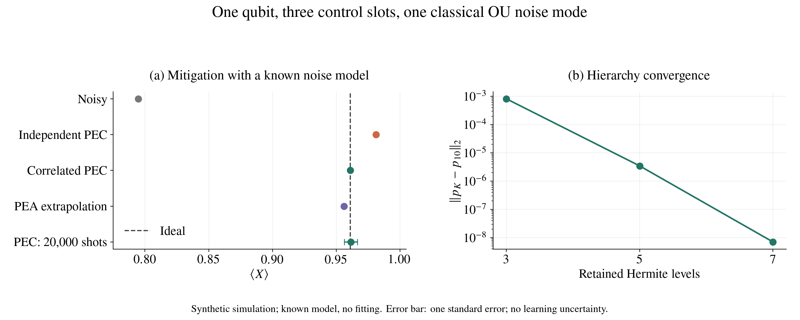

# 周四讨论：SPP 参数规模与张量网络的计算可行性

初稿：2026-11-02；数值证据更新：2026-11-04。用于 2026-11-05（周四）与张老师讨论，优先回应 SPP 参数空间过大的问题。以下新增结果来自本仓库 `spp_tn` 的已归档合成模拟；本次整理没有重跑模拟。

## 11 月 4 日新增：明天可展示的结果

建议先展示四比特的表示规模与独立对照，回应参数量问题，再用单比特完整闭环说明时间相关性对缓解的影响。收敛图作数值依据。

### 四比特：无需生成完整历史表的构造已跑通

- 四比特、四层有限控制，**仅第 0 比特一个 OU 模，Hermite 层级保留 3 级**。
- 完整联合表有 `256^4 = 4,294,967,296` 项；float64 直接存储为 32 GiB。
- 实际输出时间 MPS 键为 `(3,3,3)`，共 **6144 个复数系数**，complex128 原始数组约 **96 KiB**。这是最终表示大小，不是峰值内存，也不是去掉规范自由度后的参数数目。
- 与相同层级截断的稀疏指数传播参考相比，联合张量 L2 差为 **2.4684e-5**，最大单层边缘差为 **1.0238e-5**。参考也采用顺序构造，未展开完整历史表。
- 当前 MPS 传播耗时约 213 s，参考约 10.2 s；两次运行并发启动，不能作为受控性能基准，也没有加速结论。
- 此处尚无层级收敛、完整非负性证书或四比特 PEC 精度验证。单模低层级本身限制了记忆空间，不能推广为一般 SPP 都有小秩。

来源：[四比特对照记录](../results/spp_tn_ising4_mps_20261104/comparison.json)。

### 单比特：忽略时间相关性会留下 PEC 偏差

一比特、三个有限控制时段、一个经典 OU 噪声模；初态为 `|+>`，观测量为 X，误差位置采用 gate-after。

| 方法 | X 期望值 | 相对理想值的绝对偏差 |
|---|---:|---:|
| 理想 | 0.9610554383 | — |
| 含噪 | 0.7947236434 | 0.1663317949 |
| 独立层 PEC | 0.9812309469 | 0.0201755086 |
| 相关 SPP PEC | 0.9610554383 | 约 1.4e-12 |
| PEA 二次外推 | 0.9560731490 | 0.0049822893 |

独立基线由同一个 SPP 的精确单层边缘乘积构成，再将其逆用于原相关过程；没有额外引入拟合误差。相关 PEC 的极小残差是**同一个已知、截断模型内的代数抵消检查**，不是连续噪声模型或实验精度达到 1e-12。

有限 shots 的合成 PEC 为 **0.961462 ± 0.005237**（20,000 shots，一个标准误）；准概率成本因子 Gamma² = **1.47297**。没有包含实验模型学习误差。

来源：[新 conda 环境运行记录](../results/spp_tn_conda_20261104/summary.json)。

### 收敛与实现检查

- 单比特 MPS 传播与同层级稀疏指数参考的概率 L2 差：**1.9392e-8**。
- 以保留 10 级为参考，Hermite 层级 3 / 5 / 7 的概率 L2 差依次为 **8.22e-4 / 3.47e-6 / 7.04e-9**。
- 强制 HEOM 内部键为 1 或 2 时出现明显负概率；不能只展示小键与存储量而省略有效性检查。
- 单比特未压缩到最小形式的最终 MPS 有 92 个系数，完整表仅 64 项；该小例子用于正确性与缓解验证，不用于宣称存储收益。

来源：[分项收敛记录](../results/spp_tn_20261104_final/summary.json)。

[矢量 PDF](figures/spp-meeting-20261105.pdf)；[绘图脚本](plot_spp_meeting.py)。在仓库根目录运行 `conda run -n TensorCircuitNG python docs/plot_spp_meeting.py` 可从归档 JSON 重绘，需要 LaTeX/newtx。左图使用新 conda 环境复跑，右图使用此前归档的收敛扫描；两次基础概率张量 L2 差约 8.27e-15。

可直接口述：

> 这次把已知经典噪声模型下的 HEOM 到 SPP 时间 MPS，再到误差缓解的计算链跑通了。四比特四层的单模例子无需展开约 43 亿项的历史表，输出只需 6144 个张量系数，与同层级参考的差约 2.5e-5。单比特例子进一步说明，即使每层边缘完全已知，忽略时间相关性仍会留下 PEC 偏差。目前完成的是表示与算法正确性的验证；多模、长线路下的秩增长、性能以及实验学习仍待研究。

## 核心问题与开场

> 上次您指出，完整 SPP 的参数数量太大。我想先说明张量网络究竟压缩了什么，以及怎样在构造过程中避免枚举全部错误历史。关键需要验证的是：在我们关心的噪声与线路范围内，跨时间切分的有效秩是否足够低，且保持预测精度所需的键维数是否可控。

“稠密”需要区分两个概念：联合概率表的条目数量巨大，以及其中大量条目非零。张量网络主要利用低秩结构；一个概率表即使每项都非零，也可能有很小的张量网络表示。

## 建议按四页讲

### 1. 完整对象为什么大

令 n 为比特数、L 为噪声时段数，每层 Pauli 错误标签 a_j 有 d_P=4^n 个取值。完整 SPP 是联合概率 p(a_1,…,a_L)，有 d_P^L−1 个自由概率参数。

四比特时 d_P=256；HTML 方案中一个 Trotter 步有四层，因此完整表有 256^4=4,294,967,296 项。仅以 float64 保存概率就需要 32 GiB，尚未计入 HEOM、求逆和中间对象。增加 Trotter 步会进一步放大这一问题。

### 2. 张量网络压缩的是什么

把历史概率表示为开边界时间 MPS：

$$p(a_1,\ldots,a_L)=G^1(a_1)G^2(a_2)\cdots G^L(a_L).$$

其中 G^j(a_j) 是 χ_{j−1}×χ_j 矩阵，χ_0=χ_L=1。χ_j 是第 j 个时间切分的键维数。存储的张量元素数为

$$\sum_{j=1}^L d_P\chi_{j-1}\chi_j\le Ld_P\chi^2,\qquad \chi=\max_j\chi_j.$$

示例：四层、全部内部键取 χ=16 时，只需 139,264 个张量元素。这个数字只是给定键维数的存储算术，不是本项目已证实 χ=16 足够，也不是扣除规范自由度后的独立参数数目。

物理直觉：历史影响未来，往往经由环境保留的记忆传递。如果许多历史留下的记忆对未来的影响相同或近似相同，就不必逐一保存这些历史。键指标记录的是可区分的记忆方向，不一定是经典隐藏状态；一般 MPS 核可以含负数或复数。

精确定义：把 p 按过去标签 (a_1,…,a_j) 和未来标签 (a_{j+1},…,a_L) 展成矩阵，最小精确 MPS 键维数等于该矩阵的秩。近似压缩能否有效，要看奇异值尾部及截断后的任务误差。任意 SPP 的秩仍可指数增长；四层中间切分的最大秩为 256²=65,536。

### 3. 怎样直接构造，避免先生成大表

用户提供的 [HTML 方案](heom-spp-proposal-20261029.html)第 2.2–2.6 节提出：

1. 用 MPS-HEOM 保存当前层的系统与辅助密度算符（ADO），压缩层级指标；这控制一次传播的代价。
2. 当前层输入只保留上一层的 χ_{j−1} 个浴记忆基方向。每个方向分别接入 256 个系统 Pauli 算符，传播一层。
3. 收缩系统读出腿，保留浴腿；对 Pauli 标签作 Walsh 变换，得到当前错误标签与浴记忆之间的张量。
4. SVD 压缩标签与浴之间的切分，输出一个 SPP 核 G^j，并将保留下来的浴记忆基传到下一层。最后一层才闭合浴指标。

因此，按该方案每层需要 256χ_{j−1} 次线性传播，而不是分别传播 256^j 条历史。**这是传播次数，不是完整运行时间复杂度。** 总成本还取决于 HEOM 层级截断、内部 MPS 键维数、时间步数、带标签 MPS 的合并与正交化/SVD，以及中间峰值内存。

需要明确区分两种压缩：HEOM 内部的键 r_s 压缩辅助层级；SPP 的时间键 χ_j 压缩不同历史所需保留的记忆。二者没有自动同步变小的保证。四比特每层仍有 256 个标签，单独压缩时间方向也未解决随比特数增长的问题。

此构造属于已知浴模型后的前向数值计算；低参数表示不自动给出从实验计数辨识这些参数的方法。

### 4. 什么证据才能回答“算得动且算得准”

优先展示同一物理模型下三类数据，而不是先展开 PEC：

| 数据 | 回答的问题 |
|---|---|
| 各时间切分的奇异值谱、保留秩与丢弃权重 | 压缩是否有数值依据 |
| χ 扫描下的联合概率误差或留出观测预测误差，同时检查归一化与非负性 | 小键是否仍准确 |
| 层数 L 增长时，达到固定目标精度所需的 χ、HEOM 内部键、运行时间和峰值内存 | 成本是否可控，是否发生键维数膨胀 |

小尺寸用可完整枚举的结果作参考；较长线路用选定电路的直接动力学、边缘统计及留出观测作交叉检查。HEOM 层级误差、层内 MPS 误差、时间 MPS 误差分别扫描，不用单个截断权重替代最终预测误差。

PEC 放在后续：SPP 本身可压缩，不保证其准概率逆可压缩，也不保证准概率采样开销小。

## 汇报前需收紧的原文表述

以下是对 HTML 方案的数学阅读备注，原文件保持原样，尚非代码核验：

- “所有前缀产生的浴向量张成空间”与“完整概率表的最小 MPS 键空间”不必相同。前者的维数上界为 min(D,256^j)，D 为保留的 ADO 数；后者还受未来标签数 256^(L−j) 限制，因为不同浴方向可能在给定后续读出下不可区分。不能不加条件地把前向浴基的 SVD 秩直接等同于最小时间键维数。
- χ=1 表示因子化分布，但对一个相关张量强制做秩一 SVD，并不自动得到原分布的精确边缘乘积。匹配边缘的独立基线应显式构造并分别比较。
- “实际 χ 远小于 D”应作为待验证的数值问题。有限相关时间或弱噪声可以提供动机，但不是对任意参数和任意精度的小键保证。

## 当前可用证据与待补项

[已有四比特基准](spp-ising-benchmark.md)验证了单站点 I/Z、两时段的四历史 SPP，以及相关模型相对独立层的留出预测和 PEC。它完整枚举四项，没有时间 MPS，也没有 MPS-HEOM，**不能用来证明上述压缩算法已实现或具有规模优势**。

11 月 4 日新增的 `spp_tn` 已实现逐层构造和小规模核验，具体见本文开头；它采用经典 Hermite HEOM 与压缩 RK4，没有实现 HTML 中的 TDVP，也没有核验合作者的外部代码。时间切分的奇异值谱、多模/长线路的秩与峰值内存扫描仍待补充。周四可讨论下一步如何在指定噪声强度、相关时间和线路长度范围内，验证达到给定预测精度所需的记忆秩与成本是否可控，再连接实验学习。

参考：[SPP 原文](https://arxiv.org/html/2603.05474v3)，尤其 Sec. III–IV 关于从过程张量局域收缩得到 SPP，以及环境记忆与虚拟键的联系。本文的规模算术和具体汇报结构为本项目整理，不是文献或合作者已完成的数值结果。
