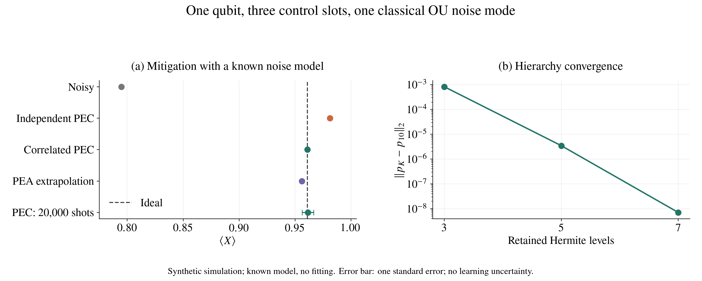

# SPP 太大了，张量网络能帮上忙吗？

2026-11-04 整理，供 11 月 5 日讨论。本文围绕 SPP 参数空间过大的问题，结合本次 `spp_tn` 数值实验说明思路与进展。所有结果均为已知噪声模型下的合成模拟，没有使用真机数据；本文整理已有运行记录，没有新增模拟。

## 1. 我们想解决什么问题？

SPP（spacetime Pauli process，时空 Pauli 过程）用联合概率描述各个时间层出现的 Pauli 错误。设线路有 $n$ 个比特、$L$ 个噪声时段，第 $j$ 层的错误标签为 $a_j$。每个标签对应一个由 $I,X,Y,Z$ 组成的 $n$ 比特 Pauli 串，共有 $d_P=4^n$ 种取值。

需要表示的对象是

$$p(a_1,\ldots,a_L).$$

如果把它完整列成一张表，就有 $4^{nL}$ 项。四比特、四层时，已经有

$$256^4=4,294,967,296$$

项，仅用 float64 保存就需要 **32 GiB**。这里首先遇到的是表太大；即使许多项非零，也不意味着它不能压缩。

我们希望利用的是：**很多不同的过去，可能只通过少数几个记忆方向影响未来。** 如果能保存这些方向，就有机会避免逐条保存所有错误历史。

## 2. 张量网络怎么把它变小？

用矩阵乘积态（MPS）形式表示这个概率张量：

$$p(a_1,\ldots,a_L)=A_1^{a_1}A_2^{a_2}\cdots A_L^{a_L}.$$

这里 $A_j^{a_j}$ 是一个 $\chi_{j-1}\times\chi_j$ 矩阵，两端 $\chi_0=\chi_L=1$。内部指标的维数 $\chi_j$ 称为键维数；它控制在第 $j$ 层之后保留多少记忆方向。

需要存储的系数数目变成

$$N_{\mathrm{MPS}}=\sum_{j=1}^{L}d_P\chi_{j-1}\chi_j.$$

如果键维数能保持较小，就可以大幅减少存储。这里的系数数目不是扣除 MPS 规范自由度后的独立参数数目。

但 MPS 并不会让任意 SPP 自动变简单。把联合概率按“过去”和“未来”展开成矩阵，其秩决定最小精确时间键维数；近似表示的效果取决于奇异值衰减。因此真正的问题是：

> 在我们关心的噪声模型和线路中，达到指定精度需要多大的键维数？它会不会随线路变长而迅速增长？

## 3. 不先生成大表，能直接构造吗？

本仓库已经实现了逐层构造。输入是已知的经典 Gaussian 噪声模型，通过 Hermite 层级运动方程（HEOM）保存噪声记忆。这里需要区分两种 MPS：

| 表示 | 压缩什么 |
|---|---|
| HEOM 内部 MPS | 系统算符与各噪声模式的辅助层级指标 |
| SPP 时间 MPS | 不同时间层之间的错误相关性 |

每一层按以下步骤进行：

1. 从上一层保留下来的记忆基出发，逐个接入系统 Pauli 探针并传播当前层。
2. 收缩系统读出指标，保留噪声记忆指标，不在层间重置记忆。
3. 使用按 Pauli 对易符号定义的 Walsh 变换，将探针响应转为错误标签表示。
4. 用奇异值分解（SVD）分离当前时间节点和后续记忆，保留指定精度所需的方向，再进入下一层。

若上一层保留 $\chi_{j-1}$ 个记忆方向，第 $j$ 层需要 $4^n\chi_{j-1}$ 次探针传播，无需分别处理全部 $4^{nj}$ 条前缀历史。**这个数是传播次数，不是总运行时间复杂度**：每次 HEOM 传播、张量合并和压缩仍然有成本。

代码位于本仓库新建的 [`spp_tn`](../spp_tn/README.md) 包。TensorCircuit-NG 提供张量收缩、QR/SVD 和线路响应计算；逐层构造及 HEOM 算法由本仓库实现。当前传播器采用四阶 Runge–Kutta（RK4）加 MPS 截断，未实现时间依赖变分原理（TDVP）传播。误差统一放在理想门之后，即 gate-after 约定。

## 4. 这次四比特实验跑出了什么？

设置是四比特 Ising 线路的四个有限控制时段，只有第 0 比特上的一个 Ornstein–Uhlenbeck（OU）噪声模，Hermite 层级保留 3 级。OU 模在这里提供随时间衰减的经典噪声相关性。

| 指标 | 本次结果 |
|---|---:|
| 完整历史表项数 | 4,294,967,296 |
| 输出 MPS 的时间键 | `(3,3,3)` |
| 输出 MPS 系数数目 | 6144 |
| complex128 系数数组大小 | 96 KiB |
| 与同层级参考的联合概率 L2 差 | $2.4684\times10^{-5}$ |
| 最大单层边缘概率差 | $1.0238\times10^{-5}$ |
| 概率归一化误差 | $1.78\times10^{-15}$ |

6144 来自 $256(1\times3+3\times3+3\times3+3\times1)$。32 GiB 与 96 KiB 分别对应完整实数概率表和实际复数 MPS 系数数组；**这是最终表示的大小比较，不是峰值内存测量。**

参考方法对相同的截断 HEOM 使用稀疏矩阵指数传播，也逐层构造 SPP，没有展开完整历史表。联合张量之差的 L2 范数通过张量网络收缩计算。参考输出的时间键为 `(2,2,2)`，也说明前向构造保留的记忆基不一定给出最终概率张量的最小表示。

这次结果支持：**逐层构造已跑通，在这个指定模型中，可以用很小的时间 MPS 表示完整历史对象，并与独立传播参考对照。**

不过，这个例子本身只有一个噪声模、3 级记忆空间，小时间键并不意外。它还不能说明充分收敛、多模或长线路下也有同样的压缩效果。完整历史非负性尚未验证，归一化接近 1 不能替代非负性检查。

本次 MPS 传播耗时约 213 s，参考约 10.2 s。两次运行并发启动，不是受控性能测试；当前也没有观察到这个小模型上的速度优势。

数据：[四比特比较记录](../results/spp_tn_ising4_mps_20261104/comparison.json)、[运行说明](../results/spp_tn_ising4_mps_20261104/README.md)。

## 5. 小系统检查：算得准吗，保留相关性有什么用？

另一个例子是一比特、三个有限控制时段、一个 OU 模。它的完整历史表只有 64 项，适合做数值检查；实际输出 MPS 有 92 个系数，因此这个例子不用于展示存储收益。

### 先检查数值误差

MPS 传播与同层级稀疏指数传播参考的概率 L2 差为 **$1.94\times10^{-8}$**。再以保留 10 级为参考，检查 Hermite 层级截断：

| 保留层级数 | 概率 L2 差 |
|---|---:|
| 3 | $8.22\times10^{-4}$ |
| 5 | $3.47\times10^{-6}$ |
| 7 | $7.04\times10^{-9}$ |

这提供了该单比特模型的层级收敛证据，不能代替四比特例子的收敛检查。强制 HEOM 内部键为 1 或 2 时，还观察到了明显负概率：**小键本身不是成功标准，必须同时检查精度和概率有效性。**

### 再检查时间相关性对缓解的影响

概率误差抵消（PEC）通过有符号的 Pauli 修正分布抵消噪声。这里比较两种输入模型：完整的相关 SPP，以及同一 SPP 的精确单层边缘乘积。后者丢掉时间相关性，但每层边缘是准确的，没有额外的拟合误差。

初态为 $|+\rangle$，观测量为 $X$：

| 方法 | $\langle X\rangle$ | 相对理想值的绝对偏差 |
|---|---:|---:|
| 理想 | 0.9610554383 | — |
| 含噪 | 0.7947236434 | 0.1663317949 |
| 独立层 PEC | 0.9812309469 | 0.0201755086 |
| 相关 SPP PEC | 0.9610554383 | 约 $1.4\times10^{-12}$ |
| 概率误差放大（PEA）后二次外推 | 0.9560731490 | 0.0049822893 |

这个例子说明：**即使每层噪声边缘完全已知，忽略时间相关性仍会留下 PEC 偏差。** 相关 PEC 的极小偏差是在同一个已知、截断模型内进行抵消的代数检查，不代表连续噪声模型或实验精度达到 $10^{-12}$。

20,000 次合成测量的 PEC 估计为 **$0.961462\pm0.005237$**，误差为一个标准误。令 $q$ 为 PEC 的有符号修正分布，$\Gamma=\sum_{\boldsymbol a}|q(\boldsymbol a)|$；本例的准概率成本因子 $\Gamma^2=1.47297$。这些结果没有计入从实验数据学习噪声模型的误差。

图左为新 conda 环境复跑，图右为此前归档的层级扫描；两次基础概率张量的 L2 差约 $8.27\times10^{-15}$。[矢量 PDF](figures/spp-meeting-20261105.pdf)与[重绘脚本](plot_spp_meeting.py)一并保存。

数据：[单比特运行记录](../results/spp_tn_conda_20261104/summary.json)、[收敛扫描](../results/spp_tn_20261104_final/summary.json)。

## 6. 下一步最值得做什么？

要回答“张量网络能否让目标问题算得动”，下一步应在固定精度要求下检查规模增长，而不只看某一次输出有多小：

| 下一步检查 | 想回答的问题 |
|---|---|
| 增加四比特模型的层级数与噪声模式数 | 当前的小时间键是否只是低维记忆截断的结果？ |
| 增加线路层数，记录各切分奇异值谱与所需时间键 | 保持精度时，记忆秩如何增长？ |
| 分别扫描 HEOM 内部键和 SPP 时间键 | 两种压缩分别引入多少误差？ |
| 记录运行时间和峰值内存，并做受控参考对比 | 最终表示小，是否也意味着构造成本可接受？ |
| 检查归一化、非负性和独立观测预测 | 压缩后是否仍是可用的概率模型？ |

本次已经验证了直接构造与小规模计算链。多模、长线路下的可控成本，以及从实验数据学习这个表示，仍需要进一步证据。SPP 本身容易压缩，也不保证它的 PEC 逆同样容易压缩或采样成本低。
